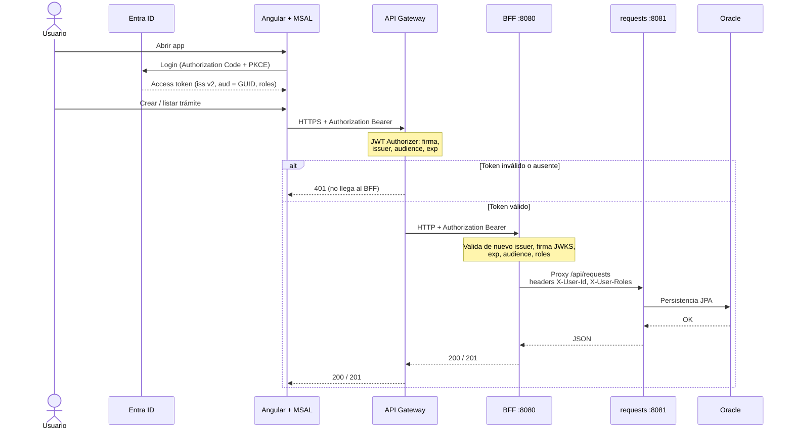
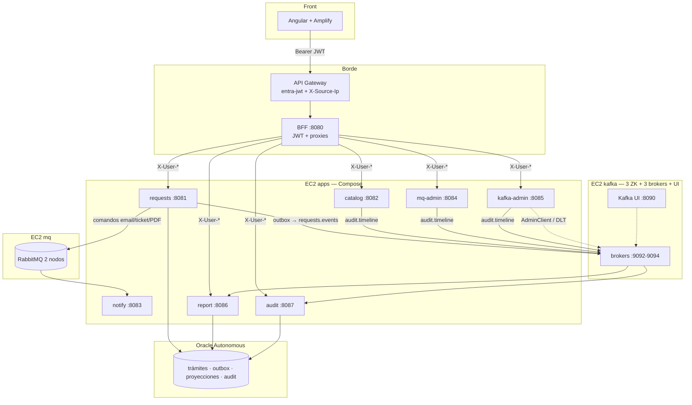

# Arquitectura — BarrioDigital

EP1 (login → Gateway → BFF → requests → Oracle) más el recorte EP2/EP3 de mensajería: RabbitMQ, Kafka, report, audit y kafka-admin.  
URLs y contratos: `decisiones.md`. Kafka operativo: `docs/kafka.md`.

## Vista en 30 segundos

```mermaid
flowchart LR
  subgraph Usuarios
    V[Vecino / Funcionario / Admin / Auditor]
  end

  subgraph Azure["Microsoft Entra ID"]
    AD[App Registration BarrioDigital<br/>OIDC + App Roles]
  end

  subgraph Front["frontend-barriodigital"]
    ANG[Angular + MSAL<br/>Amplify Hosting]
  end

  subgraph AWS["AWS"]
    GW[API Gateway HTTP API<br/>barriodigital-http<br/>JWT Authorizer]
    subgraph Back["EC2 — mundo apps, Docker Compose"]
      BFF[ms-barriodigital-bff<br/>:8080]
      REQ[ms-barriodigital-requests<br/>:8081]
    end
  end

  subgraph Datos["Oracle Cloud"]
    ORA[(Autonomous DB<br/>+ wallet)]
  end

  V -->|1. Login| AD
  AD -->|2. Access token JWT| ANG
  ANG -->|3. HTTPS + Bearer JWT| GW
  GW -->|4. HTTP + Bearer JWT| BFF
  BFF -->|5. HTTP + X-User-Id / X-User-Roles| REQ
  REQ -->|6. JDBC| ORA
```

En desarrollo local el front corre con `ng serve` en `http://localhost:4200` y le pega directo al BFF (`http://localhost:8080`), sin Gateway.

## Flujo de una petición autenticada

## Qué valida cada capa (EP1)

| Capa | Responsabilidad |
|------|-----------------|
| **Entra ID** | Identidad, App Roles (`Admin`, `Funcionario`, `Vecino`, `Auditor`), emite JWT |
| **Angular + MSAL** | Login/logout, guarda token, manda `Authorization: Bearer` al API Gateway (en local, al BFF) |
| **API Gateway** | JWT Authorizer: firma, issuer, audience (GUID) y `exp`; 401 sin llamar al BFF. Solo enruta las rutas publicadas (`decisiones.md`) |
| **BFF** | Resource Server: vuelve a validar issuer, audience, firma y `exp`; roles → 403 en `/api/admin/**`; CORS; proxy a requests |
| **requests** | CRUD trámites; filtra por dueño si es Vecino; **no** valida JWT (confía en headers del BFF) |
| **Oracle** | Tabla de trámites; wallet fuera del repo |

Contrato resumido (detalle en `decisiones.md`):

- Issuer: `https://login.microsoftonline.com/<tenant>/v2.0`
- Audience: GUID del client id (lo que traen los tokens v2); el BFF acepta además `api://<clientId>`
- Roles en claim `roles`
- Scope API: `api://…/access_as_user`

## EP2/EP3 — mensajería y proyección

| Pieza | Rol |
|---|---|
| **ec2-kafka** | Clúster 3+3 + UI. Compose en `kafka/`. Sin auto-create de tópicos. |
| **kafka-admin** | Crea tópicos sistema, API Admin de tópicos/grupos/DLT, publica en `audit.timeline`. |
| **requests** | Dueño del dominio del trámite; outbox → `requests.events`; comandos a Rabbit. |
| **report** | Consume `requests.events` (`report-group`); KPIs/SLA en proyección Oracle. |
| **audit** | Consume `audit.timeline` (`audit-group`); timeline de `requests.events` según EP3-40/42. |
| **catalog / mq-admin** | Ops admin → `audit.timeline` (con `sourceIp`). |
| **notify** | Consume Rabbit (no Kafka). |

Flujo autenticado EP1 (arriba) no cambia: JWT solo en Gateway + BFF; hacia abajo `X-User-*` y, a catalog/mq/kafka-admin, `X-Source-Ip`.

## Despliegue de referencia (lab)

| Pieza | Dónde |
|-------|--------|
| Front | AWS Amplify Hosting; local `ng serve` → `http://localhost:4200` |
| API Gateway | HTTP API `barriodigital-http`, JWT Authorizer, delante del BFF |
| BFF + MS | EC2 apps: `apps/compose.ec2.yml` o layout JAR `apps/compose.ec2.jars.yml`; local `apps/compose.yml` |
| RabbitMQ | EC2 mq (`mq/compose.yml`) |
| Kafka | EC2 kafka (`kafka/compose.yml` / compose.ec2); UI `:8090` |
| Oracle | Autonomous en OCI; wallet en volumen `/wallet`, no en Git |
