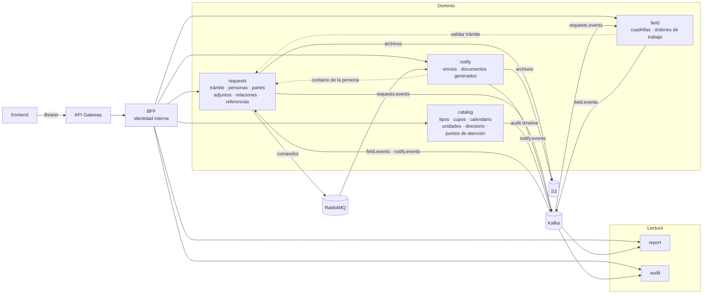

## Contrato: mapa de contextos y límites de servicios (EP3.5-02)

Define qué servicio es dueño de cada dato en EP3.5, qué API expone, qué eventos publica y consume, y con qué consistencia. Es la base de las tareas que agregan entidades o servicios: EP3.5-11 (documentos y adjuntos), EP3.5-13 (capacidades), EP3.5-14 (unidades y directorio), EP3.5-15 (personas), EP3.5-16 (ingreso asistido), EP3.5-24 (terreno), EP3.5-27 (notificaciones), EP3.5-30 (relaciones) y EP3.5-37 (referencias externas).

Las entidades están en [`dominio-modelo.md`](dominio-modelo.md), la identidad en [`identidad.md`](identidad.md), el servicio de terreno en [`field.md`](field.md) y las integraciones diferidas en [`integraciones-diferidas.md`](integraciones-diferidas.md). El reparto de memoria está en [`../operacion/plan-memoria-apps.md`](../operacion/plan-memoria-apps.md).

### 1. Principios

1. **Un dato, un dueño.** Solo el servicio dueño escribe un dato. Los demás guardan su identificador o una copia de solo lectura (snapshot) que no vuelven a sincronizar, como ya hace requests con `procedureLabel` y `slaBusinessDays`.
2. **Referencias por identificador, sin claves foráneas entre servicios.** Cada servicio tiene su propio usuario de base (EP3.5-06), así que una referencia a otro servicio es una columna con el id, sin `FOREIGN KEY`. Quien recibe la referencia la valida con el dueño solo cuando la operación exige que exista (sección 4).
3. **Los datos personales viven en su dueño.** Nombre, RUN, correo y teléfono del vecino están solo en requests. Los demás servicios guardan `personId`. Ningún evento de Kafka ni comando de RabbitMQ lleva RUN, teléfono ni correo de una persona (sección 5).
4. **Eventos por outbox.** Todo tipo de evento nuevo se escribe en el outbox en la misma transacción del cambio, como define EP3-02. Los tipos nuevos se despliegan primero en sus consumidores (convención 11 del backlog).
5. **Sin orquestación nueva en el BFF.** Una operación que cambia datos de dos servicios se coordina por eventos, no con dos escrituras desde el BFF. La reserva de cupo de la admisión sigue como hoy y es un límite conocido (sección 7).
6. **A lo más un servicio nuevo.** EP3.5 agrega solo `ms-barriodigital-field`. Personas quedan en requests; configuración, territorio, calendario, unidades, directorio y puntos de atención en catalog; documentos generados y notificaciones en notify, que suma base de datos.

### 2. Mapa

Las flechas punteadas son las llamadas internas de la sección 4.

### 3. Contextos

| Contexto | Servicio | Dueño de | API | Publica | Consume | Consistencia |
|---|---|---|---|---|---|---|
| Trámite y personas | requests | Trámite, historial, asignación, gestiones, preferencias, personas y su contacto, partes del trámite, relaciones entre trámites, adjuntos y referencias externas | `/api/requests/**`, `/api/persons/**` | `requests.events`; comandos de RabbitMQ a notify | `field.events` y `notify.events` (`requests-group`) | Fuerte dentro de un trámite, con la transacción y el bloqueo de EP3-02. Eventual hacia report, audit, field y notify |
| Configuración y territorio | catalog | Tipos de trámite, cupos, plazos, calendario, sectores, unidades municipales, directorio de personal y puntos de atención | `/api/catalog/**` | `audit.timeline`, con antes y después de cada cambio (convención 13) | - | Fuerte en su base. Quien usa un dato de catalog guarda su id y, si lo necesita para la historia, un snapshot |
| Terreno | field | Cuadrillas, integrantes, especialidades, órdenes de trabajo y visitas | `/api/field/**` | `field.events`; `audit.timeline` para la configuración de cuadrillas | `requests.events` (`field-group`) | Fuerte dentro de una orden. Eventual con requests en ambos sentidos |
| Comunicaciones y documentos | notify | Registro de envíos, documentos generados y sus versiones, y plantillas (EP3.5-27 y EP3.5-29) | `/api/notify/**` (EP3.5-11 y EP3.5-29) | `notify.events`, con el resultado de cada envío ([`comunicaciones.md`](comunicaciones.md), sección 8) | Comandos de RabbitMQ | Eventual. La idempotencia pasa a ser persistente (ARQ-02, EP3.5-10) |
| Analítica | report | Proyecciones de KPIs, plazos y órdenes | `/api/report/**` | - | `requests.events`, `field.events` (`report-group`) | Eventual. Reconstruible desde los tópicos |
| Auditoría | audit | Registro histórico de eventos | `/api/audit/**` | - | `requests.events`, `audit.timeline`, `field.events`, `notify.events` (`audit-group`) | Eventual. Registro definitivo en Oracle |
| Mensajería | mq-admin, kafka-admin | Ningún dato de dominio | Las de EP3-03 y EP2 | `audit.timeline` | - | No aplica |
| Borde | BFF | Ningún dato propio. Resuelve la identidad interna, aplica capacidades y compone vistas | `/api/**` pública | - | - | Sin estado |

**Por qué los adjuntos quedan en requests y los documentos generados en notify.** Ver un archivo depende de quién es parte del trámite, y eso lo decide requests. Si notify fuera dueño de los adjuntos, tendría que replicar la regla de acceso de cada parte. Los documentos que genera notify (comprobantes, certificados, actas) se piden a través del BFF, que primero comprueba el acceso al trámite con requests con la misma regla del detalle (404 si no es parte) y después los obtiene de notify.

### 4. Llamadas internas entre servicios

Fuera de los proxies del BFF, solo existen estas llamadas. Usan rutas `/internal/**`, que el BFF no expone y el Gateway no enruta, con la identidad firmada de servicio de EP3.5-07.

| Origen | Destino | Para qué | Si falla |
|---|---|---|---|
| BFF | requests | Resolver la persona del vecino desde el token (`identidad.md`, sección 2) | La operación responde 503 y no se crea nada |
| BFF | catalog | Resolver al funcionario en el directorio (EP3.5-14) | 503 |
| field | requests | Validar los trámites de una orden nueva y tomar su snapshot de terreno (`field.md`, sección 4) | La orden no se crea y la API responde 503 |
| notify | requests | Obtener el contacto vigente de la persona destinataria al momento de enviar | El comando se reintenta según EP2-03 y, agotados los reintentos, va a su DLQ. No se envía sin destino |
| requests | catalog | Reservar cupo al admitir desde la lista de espera (`procedimiento-estados.md`, sección 6.3; EP3.5-35) | El trámite sigue en espera, sin perder su lugar, y se reintenta el día hábil siguiente |

notify no guarda una copia del contacto. Su registro de envío conserva el destino completo usado en las comunicaciones `FORMAL`, porque es la prueba de la comunicación, y solo el destino enmascarado en las demás ([`comunicaciones.md`](comunicaciones.md), sección 4.6).

### 5. Mensajería

#### 5.1 Tópico nuevo `field.events`

| Parámetro | Valor |
|---|---|
| Productor | field, por outbox |
| Key | `workOrderId` |
| Consumidores | requests (`requests-group`), report (`report-group`), audit (`audit-group`) |
| DLT | `field.events.requests.DLT`, `field.events.report.DLT`, `field.events.audit.DLT` |
| Parámetros | Los de `requests.events` (EP3-01, sección 2): 3 particiones, 3 réplicas, `min.insync.replicas=2`, `delete` y 7 días. Las DLT, como las demás |

Lo crea kafka-admin como tópico del sistema. Cumple la regla entre retenciones de EP3-01 con los mismos valores. Los tipos de evento están en `field.md`, sección 5.

#### 5.2 Consumo nuevo de `requests.events`

field lee `requests.events` con el grupo `field-group` y la DLT `requests.events.field.DLT`, para cancelar las órdenes activas de un trámite que llega a un estado terminal (`field.md`, sección 6).

#### 5.3 Datos personales en los comandos de RabbitMQ

Los comandos hacia notify reemplazan `solicitanteEmail` por `recipientPersonId`, y notify resuelve el contacto con la llamada de la sección 4. Así la DLQ y los logs del broker no guardan correos.

La transición la hace EP3.5-15, en este orden:

1. notify acepta `recipientPersonId` y, si viene, lo usa en vez de `solicitanteEmail`.
2. requests envía los dos campos.
3. requests deja de enviar `solicitanteEmail`.

El comando `notification.requested` sigue la misma transición, con `recipientPersonId` y `recipientEmail`. La matriz de qué se comunica en cada paso está en [`comunicaciones.md`](comunicaciones.md).

#### 5.4 El actor en los eventos

`actor.id` mantiene su significado actual (EP3-01, sección 4). EP3.5-15 agrega `actor.subjectType` y `actor.subjectId` como campos opcionales compatibles, sin subir `schemaVersion`. Reemplazar `actor.id` por el identificador interno sería un cambio incompatible y queda para cuando todos los consumidores lean los campos nuevos.

### 6. Casos entre servicios

| Caso | Regla |
|---|---|
| Una orden llega a requests para un trámite ya cerrado | requests no cambia el estado. Registra el hecho en el historial interno, y field retira el trámite de la orden al leer el cierre en `requests.events`, o la cancela si era su único trámite (`field.md`, sección 6.3) |
| Un evento llega dos veces | Cada consumidor lo reconoce por `eventId` (EP3-02, sección 9) |
| Eventos de dos órdenes del mismo trámite llegan intercalados | requests mantiene el estado de cada orden con su `sequence` y deriva el estado del trámite del conjunto (`field.md`, sección 6) |
| requests no responde cuando notify resuelve un contacto | Reintentos y DLQ (sección 4). El aviso queda pendiente, no perdido |
| La persona no tiene un contacto para el canal | notify registra el envío `SIN_DESTINO`. Una comunicación `FORMAL` queda pendiente por otro medio ([`comunicaciones.md`](comunicaciones.md), sección 4.5) |
| field no responde | Las órdenes no se crean ni avanzan. Los trámites siguen operables en todo lo que no depende de terreno |

### 7. Límites conocidos

1. **Cupo orquestado por el BFF.** La admisión reserva cupo en catalog y cambia el estado en requests desde el BFF, con los resultados inciertos que describe ARQ-06. EP3.5 no lo cambia.
2. **Un relay por servicio.** Los relays de outbox de requests, catalog y field asumen una sola instancia (ARQ-03).
3. **Puertos en el host.** Hoy requests publica el 8081 y el BFF el 8080. EP3.5-07 retira los puertos de los servicios internos; field nace sin publicarlo.
4. **Snapshot sin sincronizar.** Si cambia la dirección de un trámite después de crear su orden, la orden conserva la anterior. La jefatura la corrige reprogramando la orden.
