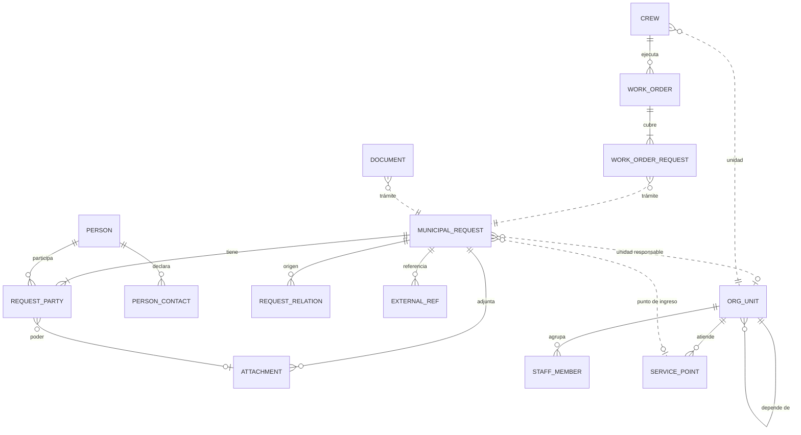

## Contrato: modelo de dominio ampliado (EP3.5-02)

Define las entidades que EP3.5 agrega alrededor del trámite, su dueño, qué datos personales guarda cada una y cómo se migran los titulares actuales. El dueño de cada contexto está en [`dominio-contextos.md`](dominio-contextos.md). Cada tarea que implementa una entidad puede agregar columnas técnicas (versión, auditoría de fila), pero no cambia su dueño, sus valores de enum ni sus reglas de minimización sin actualizar este contrato.

### 1. Diagrama

Las líneas punteadas son referencias entre servicios, por identificador y sin clave foránea (`dominio-contextos.md`, principio 2).

| Servicio | Entidades |
|---|---|
| requests | `municipal_requests`, `person`, `person_contact`, `request_party`, `request_relation`, `attachment`, `external_ref` |
| catalog | `org_unit`, `staff_member`, `service_point` |
| field | `crew` y `work_order`, con sus tablas de detalle (`field.md`) |
| notify | `document` |

### 2. Convenciones

1. Identificadores `uuid` en `VARCHAR2(36)`, como `municipal_requests.id`.
2. Instantes en `TIMESTAMP WITH TIME ZONE`, en UTC hacia la API.
3. Columnas y campos en inglés; valores de enum en español y mayúsculas (convención 14 del backlog).
4. Cada entidad editable registra `created_at`, `updated_at` y el identificador interno de quien la creó (`identidad.md`, sección 1).

### 3. Entidades de requests

#### 3.1 `person`

Una persona natural que participa en trámites: titular, representante o interesado. El personal municipal no es `person`: está en el directorio de catalog (sección 4.2). Un funcionario que además es vecino tiene dos identidades separadas, una en cada contexto.

| Columna | Tipo | Regla |
|---|---|---|
| `id` | uuid | PK. Es el `personId` |
| `identity_provider` | enum | `ENTRA`, `CLAVEUNICA` o `SIMULADO`. Nulo si la persona no tiene cuenta (registrada en atención asistida) |
| `external_subject` | string(64) | Identificador de la persona en su proveedor: el `oid` en Entra ID. Único junto con `identity_provider`. Nulo si no tiene cuenta y en `CLAVEUNICA`, donde la llave es el RUN (`identidad.md`, sección 4.1) |
| `id_document_type` | enum | `RUN`, `PASAPORTE` u `OTRO`. Nulo si no se declaró |
| `id_document_number` | string(20) | RUN normalizado sin puntos, con guion y dígito verificador en mayúscula (`12345678-K`) |
| `id_document_source` | enum | `PROVEEDOR` (lo entregó un proveedor de identidad verificado) o `DECLARADO` |
| `full_name` | string(200) | Obligatorio |

Reglas:
- Un documento con origen `PROVEEDOR` es único por tipo y número.
- Un documento `DECLARADO` puede repetir uno verificado. La vinculación entre ambos exige que la persona verificada la confirme (sección 3.3).
- `SIMULADO` existe solo en las pruebas automáticas (`identidad.md`, sección 3).

#### 3.2 `person_contact`

Un medio de contacto de la persona.

| Columna | Tipo | Regla |
|---|---|---|
| `id` | uuid | PK |
| `person_id` | uuid | FK a `person` |
| `type` | enum | `CORREO` o `TELEFONO` |
| `value` | string(254) | Correo en minúsculas, o teléfono en formato E.164 (`+56912345678`) |
| `verification_status` | enum | `DECLARADO`, `VERIFICADO` o `REBOTADO` |
| `verified_at` | instant | Con valor solo si `verification_status` es o fue `VERIFICADO` |
| `preferred` | boolean | A lo más un contacto preferido por tipo y persona |

Único por `person_id`, `type` y `value`. Si la persona registra un correo rebotado otra vez, se reutiliza la misma fila y vuelve a `DECLARADO`. EP3.5-15 define la verificación por código y la acción ante un rebote. EP3.5-03 define cuándo un contacto `DECLARADO` sirve para avisar (E9: el teléfono solo si está verificado).

#### 3.3 `request_party`

El papel de una persona en un trámite.

| Columna | Tipo | Regla |
|---|---|---|
| `id` | uuid | PK |
| `request_id` | uuid | FK a `municipal_requests` |
| `person_id` | uuid | FK a `person` |
| `role` | enum | `TITULAR`, `REPRESENTANTE`, `INTERESADO` o `ADHERENTE` |
| `link_status` | enum | `VINCULADA` o `PENDIENTE_CONFIRMACION` |
| `power_attachment_id` | uuid | FK a `attachment`. El poder del representante, cuando se exige (EP3.5-16) |
| `confirmed_at` | instant | Momento de la confirmación, si la hubo |

Reglas:
- **Un titular por trámite.** Siempre hay exactamente una fila `TITULAR`.
- **Único** por `request_id`, `person_id` y `role`.
- **Quién actúa.** Solo un `TITULAR` o un `REPRESENTANTE` con `link_status = VINCULADA` ve el trámite completo y actúa sobre él (calificar, cancelar, comentar). `INTERESADO` y `ADHERENTE` reciben los avisos que defina EP3.5-03 y ven solo la versión pública del historial.
- **Ingreso asistido.** Cuando la oficina registra un trámite con un RUN declarado que coincide con una persona con cuenta, la parte queda `PENDIENTE_CONFIRMACION`. El trámite aparece al vecino solo cuando confirma, y la confirmación queda en el historial (EP3.5-15, criterio 8).
- **Ningún evento lleva datos de la parte**, solo `personId` y `role`.

#### 3.4 `request_relation`

Una relación entre dos trámites (EP3.5-30).

| Columna | Tipo | Regla |
|---|---|---|
| `id` | uuid | PK |
| `source_request_id` | uuid | FK a `municipal_requests` |
| `target_request_id` | uuid | FK a `municipal_requests`. Distinto del origen |
| `type` | enum | `DUPLICADO_DE` o `RELACIONADO` |
| `reason` | string(500) | Motivo interno, opcional |

Reglas:
- Única por origen, destino y tipo.
- Un trámite tiene a lo más un `DUPLICADO_DE`, y el destino de un `DUPLICADO_DE` no es a su vez duplicado de otro. Así el trámite principal siempre está a un salto.

#### 3.5 `attachment`

Un archivo que sube el vecino o el personal (EP3.5-11). El contenido vive en S3, nunca en la base.

| Columna | Tipo | Regla |
|---|---|---|
| `id` | uuid | PK |
| `request_id` | uuid | FK a `municipal_requests` |
| `uploaded_by_type` | enum | `VECINO` o `PERSONAL` |
| `uploaded_by_id` | uuid | `personId` o `staffId` |
| `purpose` | enum | `EVIDENCIA`, `PODER` o `PAPEL_DIGITALIZADO` |
| `visibility` | enum | `PUBLICA` (la ven las partes) o `INTERNA` (solo el personal). Lo que sube el vecino es siempre `PUBLICA` |
| `content_type` | string(100) | Tipo detectado por contenido, no el que declara el cliente |
| `size_bytes` | número | Dentro de la cuota de EP3.5-11 |
| `sha256` | string(64) | Huella del contenido |
| `storage_key` | string(300) | Clave en S3. Nunca sale del servicio |
| `scan_status` | enum | `PENDIENTE`, `LIMPIO`, `INFECTADO` o `SIN_ANALISIS` (si el antivirus no está desplegado, `operacion/plan-memoria-apps.md`) |

Un archivo `PENDIENTE` o `INFECTADO` no se descarga. La descarga pasa siempre por el BFF.

#### 3.6 `external_ref`

Un identificador del trámite en un sistema municipal externo, como la Oficina de Partes (EP3.5-37, INT-05).

| Columna | Tipo | Regla |
|---|---|---|
| `id` | uuid | PK |
| `request_id` | uuid | FK a `municipal_requests` |
| `system` | enum | `OFICINA_DE_PARTES`, `GESTOR_DOCUMENTAL`, `JUZGADO_POLICIA_LOCAL`, `TRANSPARENCIA` u `OTRO` |
| `reference` | string(100) | El número en ese sistema |

`reference` es un identificador, no texto libre: no lleva nombres ni datos de contacto.

#### 3.7 Columnas nuevas de `municipal_requests`

| Columna | Tarea | Regla |
|---|---|---|
| `org_unit_id` | EP3.5-14 | Unidad responsable, según el enrutamiento por tipo y sector (E9) |
| `intake_channel` | EP3.5-16 | `WEB`, `PRESENCIAL`, `TELEFONO` o `CORREO` |
| `service_point_id` | EP3.5-16 | Punto de atención donde se ingresó. Nulo en `WEB` |

`solicitante_id`, `solicitante_nombre` y `solicitante_email` se eliminan con la migración de la sección 6.

### 4. Entidades de catalog

#### 4.1 `org_unit`

Una unidad municipal (EP3.5-14): `id`, `code` único, `name`, `parent_id` (nulo en la raíz), `type` (`DIRECCION`, `DEPARTAMENTO`, `SECCION` u `OFICINA`) y `active`. Una unidad con trámites abiertos no se desactiva hasta reasignarlos.

#### 4.2 `staff_member`

Un funcionario del directorio (EP3.5-14): `id` (el `staffId`), `entra_oid` único, `full_name`, `position` (cargo), `org_unit_id` y `active`. El vecino ve la unidad y el cargo del responsable, nunca su nombre (E9). Un funcionario dado de baja queda `active = false` y conserva su historia.

#### 4.3 `service_point`

Un lugar donde se atiende a vecinos (EP3.5-16): `id`, `code` único, `name`, `type` (`OFICINA_MUNICIPAL`, `OFICINA_COMUNAL` o `JUNTA_DE_VECINOS`), `sector`, `address`, `org_unit_id` y `active`. Las juntas de vecinos son ficticias, y en el piloto se atiende solo a través de las oficinas (D-04).

### 5. Entidades de field y notify

- **`work_order` y `crew`** (field): ver [`field.md`](field.md), sección 3.
- **`document`** (notify, EP3.5-11 y EP3.5-29): `id`, `request_id`, `type` (`COMPROBANTE` o `CERTIFICADO_RESOLUCION`; EP3.5-29 agrega los demás), `version` (empieza en 1 y sube al regenerar), `storage_key`, `sha256`, `source_event_id` (idempotencia) y `generated_at`. Único por `request_id`, `type` y `version`. EP3.5-29 suma el código de verificación.

### 6. Minimización

| Dato | Vive en | Quién lo ve | ¿Viaja en eventos o comandos? |
|---|---|---|---|
| Nombre de la persona | `person` | Ella misma; el personal con acceso al trámite | No. Solo `personId` |
| RUN o documento | `person` | Ella misma; el personal de atención que la registra o la identifica | Nunca. Tampoco en logs |
| Correo | `person_contact` | Ella misma; el personal con acceso al trámite. El Auditor no | No. notify lo resuelve al enviar |
| Teléfono | `person_contact` | Ella misma y el responsable del trámite. El Auditor no (EP3.5-15) | Nunca |
| Papel en el trámite | `request_party` | Las partes y el personal | Solo `personId` y `role` |
| Poder del representante | S3, por `attachment` | El representante, el titular y el personal | No |
| Dirección del trámite | `municipal_requests`; snapshot en `work_order_request` | Las partes, el personal y la cuadrilla asignada | No en Kafka (EP3-01, sección 8). Sí en la API de field |
| Nombre del funcionario | `staff_member` | El personal. El vecino ve unidad y cargo | Como `actor.name` en los eventos, como hoy |

La retención y la anonimización de estos datos son de EP3.5-38. El inventario de tratamientos es de EP3.5-18.

### 7. Migración de los titulares actuales

La ejecuta EP3.5-15 con las migraciones versionadas de EP3.5-06. Es en dos fases: primero se agrega lo nuevo sin quitar nada, y las columnas antiguas se eliminan cuando nadie las lee.

**Fase 1: agregar y poblar.**

1. Crear `person`, `person_contact` y `request_party`. Es aditivo: la versión anterior de requests sigue funcionando.
2. Desplegar la versión de requests que, en cada alta, crea o reutiliza la persona, crea la parte `TITULAR` y sigue llenando las columnas `solicitante_*`.
3. Poblar los trámites existentes con un script idempotente, que se puede repetir sin duplicar:
   - por cada `solicitante_id` distinto sin persona, una `person` con `identity_provider = ENTRA` y `external_subject = solicitante_id`;
   - `full_name` es el `solicitante_nombre` no nulo del trámite más reciente (por `created_at` y después `id`); si todos son nulos, el mismo respaldo de `actor.name` (EP3-01, sección 4);
   - el `solicitante_email` no nulo más reciente, como `person_contact` `CORREO` `DECLARADO` y preferido. Si no hay ninguno, la persona queda sin contacto;
   - por cada trámite sin titular, una parte `TITULAR` `VINCULADA`.
4. Verificar con los datos actuales:
   - cada trámite tiene exactamente un titular;
   - hay tantas personas `ENTRA` como `solicitante_id` distintos;
   - ningún trámite queda sin titular.
5. requests pasa a decidir la propiedad del trámite (el 404 al vecino ajeno) con `request_party`.

**Fase 2: retirar.** Cuando el BFF, la exportación CSV y notify (con `recipientPersonId`, `dominio-contextos.md`, sección 5.3) dejan de leer `solicitante_*`, una migración posterior elimina las tres columnas.

**Reversión.** La fase 1 solo agrega. Volver a la versión anterior de requests deja las tablas nuevas sin uso y no pierde trámites. La fase 2 no tiene reversión y por eso corre solo después de verificar la fase 1 en la nube.
