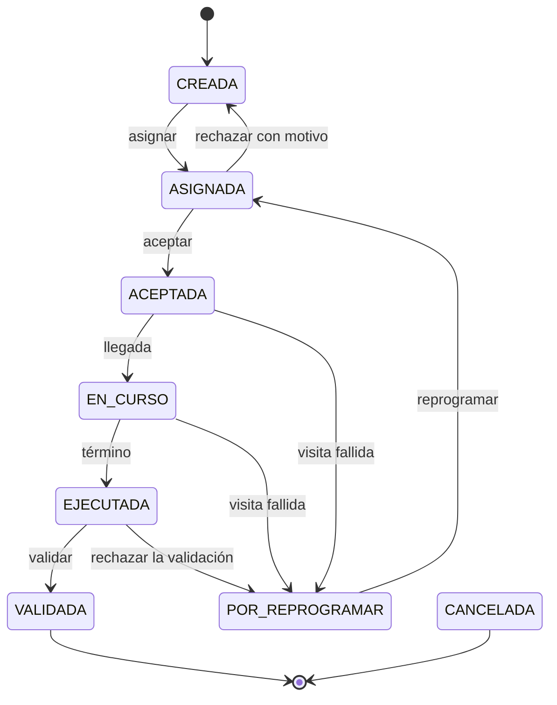

## Contrato: servicio de terreno `ms-barriodigital-field` (EP3.5-02)

Define el servicio de cuadrillas y órdenes de trabajo antes de su código: datos, API, eventos y relación con el estado del trámite. Lo implementa EP3.5-24, en su versión del piloto: la cuadrilla trabaja en una vista web, y la agenda y la aplicación sin conexión llegan en el tramo 3. Reemplaza el comando `crew.ticket`, que hoy solo queda en el log de notify (EP2-01). Sus límites con los demás servicios están en [`dominio-contextos.md`](dominio-contextos.md).

### 1. Servicio

| Aspecto | Regla |
|---|---|
| Puerto | 8088, con `expose` y sin publicarlo en el host |
| Base | Oracle Autonomous, con su propio usuario y migraciones versionadas desde el primer commit (EP3.5-06) |
| Identidad | Valida la identidad firmada del BFF con audiencia `field` (EP3.5-07) |
| Health | Liveness y readiness separados, sin detalles públicos (EP3.5-05) |
| Memoria | 512 MiB (`operacion/plan-memoria-apps.md`) |
| Kafka | Publica `field.events` por outbox y consume `requests.events` con `field-group` |
| Arquitectura | Hexagonal, como requests y el BFF |

### 2. Capacidades

EP3.5-13 asigna estas capacidades a los roles. Este contrato fija solo qué protege cada una.

| Capacidad | Permite |
|---|---|
| Administrar cuadrillas | Crear y editar cuadrillas, integrantes, especialidades, territorio, disponibilidad y capacidad |
| Gestionar órdenes | Crear, asignar, reprogramar, validar y cancelar órdenes de su unidad |
| Ejecutar órdenes | Aceptar, rechazar, registrar llegada, término y visita fallida en las órdenes de su cuadrilla |
| Ver órdenes | Leer órdenes de su unidad, sin operar |

Un integrante solo ve las órdenes de su cuadrilla (EP3.5-24, criterio 2). La regla vive en field, no solo en el BFF.

### 3. Datos

#### 3.1 `crew`

| Columna | Tipo | Regla |
|---|---|---|
| `id` | uuid | PK |
| `name` | string(100) | Único por unidad |
| `org_unit_id` | uuid | Unidad de catalog |
| `type` | enum | `PROPIA` o `CONTRATISTA` |
| `sector` | string(40) | Territorio principal. Nulo si cubre toda la comuna |
| `daily_capacity` | entero ≥ 1 | Órdenes que puede ejecutar por día. Es la capacidad de terreno de E9 |
| `availability` | enum | `DISPONIBLE` o `NO_DISPONIBLE` |
| `active` | boolean | Una cuadrilla con órdenes activas no se desactiva |

`crew_specialty` (`crew_id`, `procedure_type`) indica los tipos de trámite que atiende la cuadrilla, con los códigos de catalog.

`crew_member` (`crew_id`, `staff_id`, `role`): `role` es `JEFE_CUADRILLA` o `INTEGRANTE`. Un funcionario está a lo más en una cuadrilla activa. Cada cuadrilla tiene un jefe.

#### 3.2 `work_order`

| Columna | Tipo | Regla |
|---|---|---|
| `id` | uuid | PK |
| `number` | string(14) | `OT-AAAA-NNNNNN`, único e inmutable. Se numera como el folio, con su propia tabla de contadores (`requests-folio.md`, sección 1) |
| `org_unit_id` | uuid | Unidad que gestiona la orden |
| `crew_id` | uuid | Nulo mientras no se asigna |
| `status` | enum | Sección 4 |
| `instructions` | string(1000) | Indicaciones para la cuadrilla. Sin datos de contacto del vecino |
| `scheduled_for` | fecha | Día previsto, en `America/Santiago`. Nulo si no se programó |
| `acceptance_due_at` | instant | Plazo para que la cuadrilla acepte |
| `status_reason` | string(500) | Motivo del último rechazo, visita fallida, rechazo de la validación o cancelación |
| `failure_reason` | enum | `SIN_ACCESO`, `VECINO_AUSENTE`, `CONDICION_CLIMATICA`, `FALTA_MATERIAL`, `VALIDACION_RECHAZADA` u `OTRO`. Con valor solo en `POR_REPROGRAMAR` |
| `version` | entero | Bloqueo optimista |

`work_order_request` (`work_order_id`, `request_id`, `folio`, `procedure_type`, `address`, `location_reference`, `latitude`, `longitude`, `sector`): los trámites que cubre la orden, de 1 a 20, con su snapshot de terreno. La orden no guarda el nombre ni el contacto del vecino.

`work_order_visit` (`work_order_id`, `arrived_at`, `finished_at`, `outcome`, `notes`): una fila por visita. `outcome` es `EJECUTADA` o `FALLIDA`. Una visita fallida guarda su motivo en la orden.

### 4. Ciclo de la orden

El ciclo de la orden es propio y separado del estado del trámite.

Toda orden que no es `VALIDADA` ni `CANCELADA` puede pasar a `CANCELADA`.

| Transición | Actor | Capacidad | Regla |
|---|---|---|---|
| Crear (`CREADA`) | Jefatura | Gestionar órdenes | Trámites abiertos, de la misma unidad (sección 6.1) |
| `CREADA` → `ASIGNADA` | Jefatura | Gestionar órdenes | Cuadrilla activa, `DISPONIBLE` y de la unidad. Fija `acceptance_due_at` |
| `ASIGNADA` → `ACEPTADA` | Integrante | Ejecutar órdenes | Solo de su cuadrilla |
| `ASIGNADA` → `CREADA` | Integrante | Ejecutar órdenes | Motivo obligatorio. La orden queda sin cuadrilla |
| `ACEPTADA` → `EN_CURSO` | Integrante | Ejecutar órdenes | Abre una visita |
| `EN_CURSO` → `EJECUTADA` | Integrante | Ejecutar órdenes | Cierra la visita. La evidencia se adjunta en requests como adjunto `INTERNA` o `PUBLICA` del personal (`dominio-modelo.md`, sección 3.5) |
| `ACEPTADA` o `EN_CURSO` → `POR_REPROGRAMAR` | Integrante | Ejecutar órdenes | `failure_reason` obligatorio; `status_reason` obligatorio si es `OTRO` |
| `POR_REPROGRAMAR` → `ASIGNADA` | Jefatura | Gestionar órdenes | La misma u otra cuadrilla |
| `EJECUTADA` → `VALIDADA` | Jefatura | Gestionar órdenes | Quien valida no es integrante de la cuadrilla que ejecutó |
| `EJECUTADA` → `POR_REPROGRAMAR` | Jefatura | Gestionar órdenes | `failure_reason = VALIDACION_RECHAZADA` y motivo obligatorio |
| Cualquiera activa → `CANCELADA` | Jefatura, o field al leer un trámite terminal | Gestionar órdenes | Motivo obligatorio |

**Plazo de aceptación.** `acceptance_due_at` es el momento de la asignación más 4 horas corridas, configurable en field. Si vence, la orden sigue `ASIGNADA` y la jefatura recibe una alerta para reasignarla (EP3.5-24, criterio 4), en `/inicio` ([`comunicaciones.md`](comunicaciones.md), fila P08).

**Capacidad.** Asignar una orden a una cuadrilla que ya tiene `daily_capacity` órdenes para ese `scheduled_for` responde 409. La jefatura elige otro día u otra cuadrilla.

### 5. API

Rutas bajo `/api/field`, a través del BFF. Las acciones del ciclo son subrecursos con `POST`, como `take` y `assignee` en requests (EP3-05).

| Método y ruta | Capacidad | Para qué |
|---|---|---|
| `GET /api/field/crews` | Ver órdenes | Cuadrillas de la unidad |
| `POST /api/field/crews` | Administrar cuadrillas | Crear |
| `PUT /api/field/crews/{id}` | Administrar cuadrillas | Editar datos, disponibilidad y capacidad |
| `PUT /api/field/crews/{id}/members` | Administrar cuadrillas | Reemplazar integrantes y jefe |
| `POST /api/field/work-orders` | Gestionar órdenes | Crear desde uno o varios trámites (`requestIds`, `instructions`, `crewId` y `scheduledFor` opcionales) |
| `GET /api/field/work-orders` | Ver o Ejecutar órdenes | Filtros `status`, `crewId`, `requestId` y `mine=true` (las de mi cuadrilla) |
| `GET /api/field/work-orders/{id}` | Ver o Ejecutar órdenes | Detalle con trámites, visitas e hitos |
| `POST /api/field/work-orders/{id}/assignment` | Gestionar órdenes | Asignar o reprogramar (`crewId`, `scheduledFor`) |
| `POST /api/field/work-orders/{id}/acceptance` | Ejecutar órdenes | Aceptar |
| `POST /api/field/work-orders/{id}/rejection` | Ejecutar órdenes | Rechazar (`reason`) |
| `POST /api/field/work-orders/{id}/arrival` | Ejecutar órdenes | Llegada |
| `POST /api/field/work-orders/{id}/completion` | Ejecutar órdenes | Término (`notes`) |
| `POST /api/field/work-orders/{id}/failed-visit` | Ejecutar órdenes | Visita fallida (`failureReason`, `reason`) |
| `POST /api/field/work-orders/{id}/validation` | Gestionar órdenes | Validar (`approved`, `reason` si es `false`) |
| `POST /api/field/work-orders/{id}/cancellation` | Gestionar órdenes | Cancelar (`reason`) |

Errores, con mensajes sin tildes como el resto del backend:

| Código | Caso |
|---|---|
| 400 | Validación: motivo faltante, más de 20 trámites, `failureReason` desconocido |
| 403 | Sin la capacidad de la acción |
| 404 | Orden o cuadrilla inexistente, o fuera de su alcance: de otra unidad, o de otra cuadrilla para un integrante sin "Ver órdenes". Como el trámite ajeno del vecino, no revela que existe |
| 409 | Transición inválida desde el estado actual, `version` desactualizada, cuadrilla sin capacidad, trámite cerrado o de otra unidad |
| 503 | requests no respondió al validar los trámites |

El vecino no llama a field. Ve los hitos públicos de sus órdenes en el historial del trámite, que requests registra al consumir `field.events` (sección 6.2).

### 6. Relación con el trámite

#### 6.1 Creación

field llama a `GET /internal/requests/{id}/field-summary` en requests por cada trámite (`dominio-contextos.md`, sección 4). La respuesta trae folio, estado, tipo, dirección, referencia, coordenadas, sector y unidad.

La orden se crea solo si todos los trámites:
- están en `ADMITIDO`, `EN_GESTION` o `EN_TERRENO`;
- pertenecen a la unidad de la orden.

Si alguno no cumple, responde 409 con el folio que falló. El snapshot se guarda en `work_order_request`.

#### 6.2 Estado del trámite derivado de las órdenes

requests consume `field.events` y guarda el último estado de cada orden de sus trámites, ordenado por `sequence`. Una orden está **activa** si no es `VALIDADA` ni `CANCELADA`.

| Situación | Efecto en el trámite |
|---|---|
| Una orden del trámite pasa a `ASIGNADA` y el trámite está en `ADMITIDO` o `EN_GESTION` | Pasa a `EN_TERRENO` y publica `email.visit`, como hoy |
| El trámite queda sin órdenes activas | Vuelve a `EN_GESTION`. Puede recibir otra orden (inspección y después reparación) |
| Se intenta pasar a `RESUELTO` | Exige que no haya órdenes activas y que toda orden no cancelada esté `VALIDADA` (EP3.5-24, criterio 6) |

Una orden rechazada que vuelve a `CREADA` sigue activa: el trámite sigue `EN_TERRENO` hasta que la jefatura la reasigna o la cancela.

Los cambios derivados se registran en el historial con el actor del evento de field. Son las transiciones T10 y T11 de la máquina de estados del trámite ([`procedimiento-estados.md`](procedimiento-estados.md), sección 4.5). Cuando field está desplegado, el personal deja de cambiar a `EN_TERRENO` a mano y requests deja de publicar `crew.ticket`.

#### 6.3 Trámite terminal

field consume `request.status-changed`, `request.cancelled`, `request.withdrawn`, `request.closed-without-contact`, `request.marked-duplicate` y `request.referred`. Cuando un trámite pasa a `RECHAZADO`, `CANCELADO`, `DESISTIDO`, `CERRADO_SIN_CONTACTO`, `DUPLICADO` o `DERIVADO` ([`procedimiento-estados.md`](procedimiento-estados.md), sección 2):
- field quita el trámite de sus órdenes activas;
- una orden que queda sin trámites pasa a `CANCELADA`, con el actor del evento de requests y el motivo `Tramite cerrado: <folio>`.

La jefatura de la unidad recibe el aviso de la fila P06 de [`comunicaciones.md`](comunicaciones.md) (EP3.5-24, criterio 7).

Un trámite reabierto (`request.reopened`) no reactiva las órdenes canceladas: la jefatura crea una orden nueva si hace falta.

### 7. Eventos de `field.events`

Usan el sobre de EP3-01, sección 4, con `producer = field` y `sequence` del outbox de field. Siguen las reglas de formato, recepción y versionado de EP3-01 (secciones 5, 10 y 11). Todos son versión 1.

| `eventType` | Cuándo |
|---|---|
| `workorder.created` | Alta de la orden |
| `workorder.assigned` | `CREADA` o `POR_REPROGRAMAR` → `ASIGNADA` |
| `workorder.accepted` | `ASIGNADA` → `ACEPTADA` |
| `workorder.rejected` | `ASIGNADA` → `CREADA` |
| `workorder.started` | `ACEPTADA` → `EN_CURSO` |
| `workorder.completed` | `EN_CURSO` → `EJECUTADA` |
| `workorder.visit-failed` | → `POR_REPROGRAMAR` |
| `workorder.validated` | `EJECUTADA` → `VALIDADA` |
| `workorder.cancelled` | → `CANCELADA` |
| `workorder.requests-changed` | Un trámite sale de una orden activa (sección 6.3) |

**Campos del payload**, presentes en todos los tipos:

| Campo | Tipo | Regla |
|---|---|---|
| `workOrderId` | uuid | No nulo |
| `number` | string | No nulo |
| `requestIds` | lista de uuid | Los trámites que cubre la orden después del cambio. Vacía solo en `workorder.cancelled` |
| `orgUnitId` | uuid | No nulo |
| `crewId` | uuid | Nulo si no tiene cuadrilla |
| `fromStatus` | enum | Nulo en `workorder.created` |
| `toStatus` | enum | No nulo |
| `scheduledFor` | fecha | Nulo si no se programó |
| `failureReason` | enum | Con valor solo en `workorder.visit-failed` |
| `reason` | string | Con valor en `rejected`, `visit-failed`, `cancelled` y en una validación rechazada |

No viajan la dirección, las coordenadas, las indicaciones ni las notas: ningún consumidor las necesita (EP3-01, sección 8). report calcula órdenes por estado, tiempo hasta la ejecución y visitas fallidas con `occurredAt`, `toStatus` y `failureReason` (EP3.5-24, criterio 9).

### 8. Despliegue

1. kafka-admin crea `field.events`, sus DLT y `requests.events.field.DLT`.
2. requests, report y audit se despliegan con el consumo de `field.events` (convención 11 del backlog).
3. Se despliega field.
4. requests deja de permitir `EN_TERRENO` manual y de publicar `crew.ticket`.

### 9. Límites conocidos

1. **Sin agenda ni modo sin conexión.** Llegan en el tramo 3. La cuadrilla necesita conexión para registrar cada paso.
2. **La cuadrilla no ve el teléfono del vecino.** Si necesita coordinar una visita, lo hace el responsable del trámite.
3. **Un relay.** El outbox de field asume una sola instancia (ARQ-03).
4. **Snapshot sin sincronizar** (`dominio-contextos.md`, sección 7).
