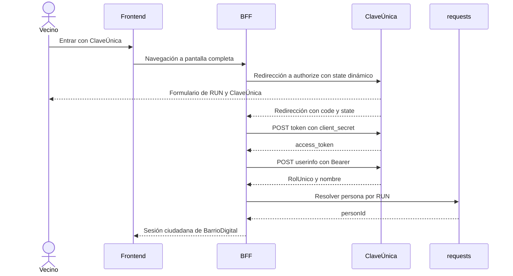

## Contrato: identidad interna y proveedores de identidad (EP3.5-02)

Define la identidad con la que BarrioDigital reconoce a cada usuario, independiente del proveedor que lo autentica, y el diseño de la integración con ClaveÚnica. Es la base de EP3.5-07 (identidad firmada entre servicios), EP3.5-13 (capacidades), EP3.5-14 (directorio) y EP3.5-15 (personas). El token de Entra ID está en [`jwt.md`](jwt.md), y las capacidades por rol en [`capacidades-roles.md`](capacidades-roles.md).

### 1. Identidad interna

El BFF valida el token del proveedor y arma esta identidad. Es lo único que los servicios conocen del usuario: ninguno vuelve a leer el token del proveedor.

| Campo | Tipo | Regla |
|---|---|---|
| `subjectType` | enum | `VECINO` o `PERSONAL` |
| `subjectId` | uuid | `personId` (requests) si es `VECINO`; `staffId` (directorio de catalog) si es `PERSONAL` |
| `provider` | enum | `ENTRA`, `CLAVEUNICA` o `SIMULADO` |
| `role` | string | El único rol de EP3-04, sección 4. EP3.5-13 lo reemplaza por las capacidades |
| `name` | string | Nombre para mostrar en el historial, con el respaldo de EP3-01, sección 4 |

No forman parte de la identidad interna:
- **el correo y el teléfono:** quien los necesita los obtiene de `person_contact` (`dominio-modelo.md`, sección 3.2);
- **el RUN:** se guarda en `person` y nunca viaja en la identidad;
- **el identificador del proveedor** (`oid`): solo lo usan el BFF y la resolución de la sección 2.

**Transporte.** EP3.5-07 firma esta identidad, con corta duración y una audiencia por servicio, y reemplaza los headers `X-User-Id`, `X-User-Name`, `X-User-Email` y `X-User-Roles`. Mientras tanto, el BFF agrega `X-Subject-Type` y `X-Subject-Id` a los headers actuales.

### 2. Resolución

1. El BFF valida el token: emisor (`iss`), firma, audiencia y expiración.
2. El emisor decide el proveedor (sección 3). Un emisor que no está en la lista responde 401.
3. El proveedor decide `subjectType`:
   - **ClaveÚnica:** siempre `VECINO`;
   - **Entra ID en producción:** siempre `PERSONAL`;
   - **Entra ID en el laboratorio:** `VECINO` si el rol es `Vecino` y `PERSONAL` en los demás casos. Es el ajuste del curso (D-02): todos entran con Entra ID.
4. El BFF obtiene `subjectId`:
   - `VECINO`: requests busca la persona por `provider` y `external_subject` (en ClaveÚnica, por el RUN verificado) y, si no existe, la crea en la misma llamada. Así la primera entrada del vecino no exige un registro previo;
   - `PERSONAL`: catalog busca al funcionario por `entra_oid` en el directorio. Si no está o está inactivo, 403 `El usuario no esta en el directorio de personal`. Hasta que EP3.5-14 cree el directorio, `subjectId` del personal es su `oid`.
5. El BFF puede guardar la resolución en memoria hasta 5 minutos. Es determinista, así que varias instancias del BFF llegan al mismo resultado.

**Orden de los errores.** La regla de EP3-04, sección 5, se amplía al principio:
1. token inválido: 401;
2. persona o funcionario sin resolver: 403;
3. **ruta del grupo contrario: 403**;
4. después, rol o capacidad.

### 3. Emisores

| Proveedor | `subjectType` | Ambiente | Validación |
|---|---|---|---|
| Entra ID del curso | `VECINO` o `PERSONAL` en el laboratorio; `PERSONAL` en producción | Laboratorio y producción | `jwt.md` |
| ClaveÚnica | `VECINO` | Solo producción, con convenio (sección 4) | La sesión ciudadana de la sección 4.2 |
| Simulado | `VECINO` | Solo pruebas automáticas | Emisor y claves generados por la prueba |

**Proveedor simulado.** Prueba que el BFF acepta un segundo emisor y separa los grupos de rutas (EP3.5-15, criterio 7). Sus claves se generan en la prueba. La lista de emisores aceptados viene de la configuración del BFF, y el compose de la nube solo trae Entra ID, así que un token simulado responde 401 fuera de las pruebas.

### 4. Diseño de la integración con ClaveÚnica

No se implementa en EP3.5: ClaveÚnica solo se entrega a órganos del Estado con un habilitante, y sus credenciales de producción exigen una certificación con un dominio `.gob.cl` (sección 2.6 del catálogo). Queda diseñada para que conectarla sea agregar un emisor y no rehacer la identidad.

Fuentes: [Guía Técnica de integración a ClaveÚnica](https://cms-dgd-prod.s3-us-west-2.amazonaws.com/uploads/pdf/Guia_Tecnica_de_integracion_a_ClaveUnica__4_1.pdf), versión 5.1 de septiembre de 2024, y los términos y condiciones de la [Resolución Exenta 733 de 2025](https://www.diariooficial.interior.gob.cl/publicaciones/2025/11/06/44292/01/2719876.pdf) de la Subsecretaría de Hacienda, publicada el 6-nov-2025. La guía advierte que toda copia es no controlada: al integrar se usa la versión vigente que publique la Secretaría de Gobierno Digital.

#### 4.1 Flujo

ClaveÚnica usa OpenID Connect con el flujo de código de autorización.

1. **El BFF es el cliente.** Las llamadas a `token/` y `userinfo/` salen del backend, como exige la certificación. El `client_secret` vive en Parameter Store o Secrets Manager (EP3.5-06), nunca en el código ni en el frontend.
2. **`state` dinámico.** El BFF genera un valor aleatorio de al menos 30 caracteres por intento, lo guarda ligado a la sesión del navegador y rechaza la respuesta si no coincide (protección contra CSRF).
3. **Scope `openid run name`**, el que exige la certificación.
4. **Pantalla completa.** El login se abre por navegación a pantalla completa, sin iframe ni ventana emergente, con el botón oficial de ClaveÚnica.
5. **El `code` vence a los 5 minutos.** Si vence, el vecino vuelve a autenticarse.
6. **El token de ClaveÚnica no sale del BFF.** Sirve para obtener los datos de la persona, no para llamar a la API de BarrioDigital.
7. **La llave es el RUN.** `userinfo` entrega `RolUnico` (`numero`, `DV`, `tipo`) y `name` (`nombres` y `apellidos`). La guía indica que `sub` no se usa como llave del registro, así que la persona se resuelve por el RUN (`id_document_type = RUN`, `id_document_source = PROVEEDOR`) y `external_subject` queda nulo.
8. **Se guardan solo el RUN y el nombre completo.** El correo y el teléfono los declara el vecino en su perfil y los verifica (EP3.5-15).

#### 4.2 Sesión ciudadana

La sesión de ClaveÚnica dura 60 segundos y el integrador administra la suya. El BFF emite un token propio de BarrioDigital:
- de corta duración, con su propio emisor y su propia audiencia;
- firmado con claves que rotan como las de EP3.5-07;
- con `subjectType = VECINO` y el `personId`.

El Gateway lo valida con un authorizer propio, separado del de Entra ID. Al vencer, el vecino vuelve a entrar con ClaveÚnica.

**Cierre de sesión.** Al cerrar la sesión de BarrioDigital, el frontend navega al endpoint de logout de ClaveÚnica con la URI de retorno registrada. También se cierra cuando el RUN autenticado no puede resolverse en requests.

#### 4.3 Vinculación por RUN

- Si la persona que entra ya existe por un trámite asistido con el mismo RUN declarado, requests no la fusiona automáticamente. El vecino ve los trámites pendientes de vincular y confirma cada uno (`dominio-modelo.md`, sección 3.3).
- Si ya existe una persona `ENTRA` del laboratorio con el mismo RUN, se aplica la misma confirmación.

#### 4.4 Casos alternativos

| Caso | Regla |
|---|---|
| Persona sin ClaveÚnica | Atención asistida en una oficina y seguimiento por folio y código (EP3.5-16 y EP3.5-17), sin contraseñas locales (D-02) |
| Persona extranjera sin RUN | Atención asistida con documento alternativo (`PASAPORTE` u `OTRO`, `DECLARADO`) |
| Funcionario que además es vecino | Dos identidades: `PERSONAL` con Entra ID y `VECINO` con ClaveÚnica. Una no hereda las capacidades de la otra |
| ClaveÚnica no disponible | El frontend muestra los canales alternativos. No hay ingreso de vecinos con Entra ID en producción: la guía indica que los organismos del Instructivo Presidencial usan ClaveÚnica como único medio de autenticación de personas naturales |

#### 4.5 Requisitos institucionales

Para integrar, el municipio:
1. solicita las credenciales por el trámite "Solicitud de Credenciales de Integración a ClaveÚnica", con un funcionario de su dotación;
2. designa una contraparte administrativa, con correo institucional, y una técnica;
3. registra un Redirect URI por ambiente (sandbox, QA y producción): sin `localhost`, sin query y, en producción, con dominio `.gob.cl`;
4. desarrolla y prueba con las credenciales de sandbox y QA, que solo admiten los RUN de prueba de la guía;
5. certifica la integración para activar las credenciales de producción. La guía estima 5 días hábiles.

Los términos y condiciones de la Resolución Exenta 733 de 2025 obligan a toda entidad usuaria sin necesidad de aceptarlos. Entre otras cosas:
- prohíben solicitar o almacenar las contraseñas de los usuarios;
- exigen avisar de inmediato a la Secretaría de Gobierno Digital ante un incidente de seguridad (EP3.5-20);
- obligan a cumplir la Ley 19.880, la Ley 19.628 y la Norma Técnica de Autenticación.

### 5. Separación de grupos de rutas

| Grupo | `subjectType` | Ejemplos |
|---|---|---|
| Ciudadanas | `VECINO` | Crear trámite, mis trámites, perfil y contacto, encuesta |
| Personal | `PERSONAL` | Bandeja, operación, administración, reportes, auditoría, terreno |
| Comunes | Ambos | Health, catálogo público de tipos, preferencias propias |

La regla vive en el BFF y se repite en cada servicio con la identidad interna (EP3-04, principio 2). Un token ciudadano recibe 403 en toda ruta del personal, aunque traiga un rol del personal. El grupo de cada ruta lo fija la matriz de capacidades de EP3.5-13.

### 6. Límites conocidos

1. **En el laboratorio, el rol decide `subjectType`.** Con un solo tenant, un usuario de Entra ID con rol `Vecino` es un vecino. En producción lo decide el emisor.
2. **Caché de 5 minutos.** Un funcionario dado de baja en el directorio puede operar hasta 5 minutos más. Entra ID sigue siendo el control principal de la baja.
3. **Sin ClaveÚnica real.** El flujo de la sección 4 no se prueba contra el servicio institucional; el proveedor simulado prueba solo la separación de emisores.
