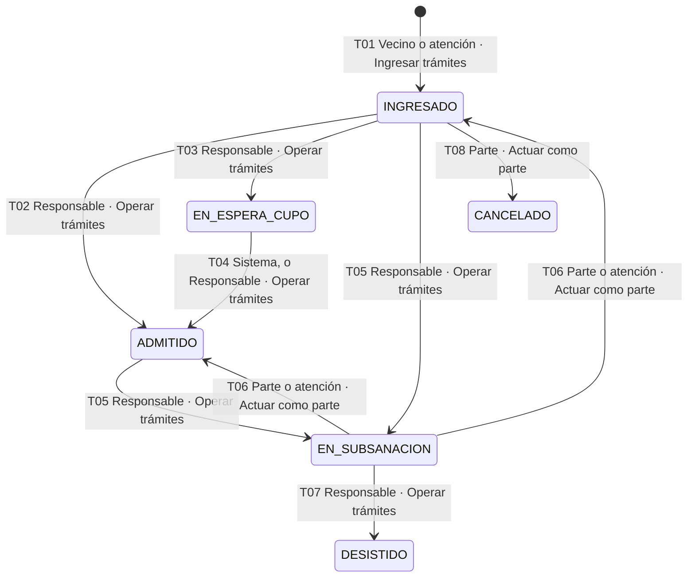
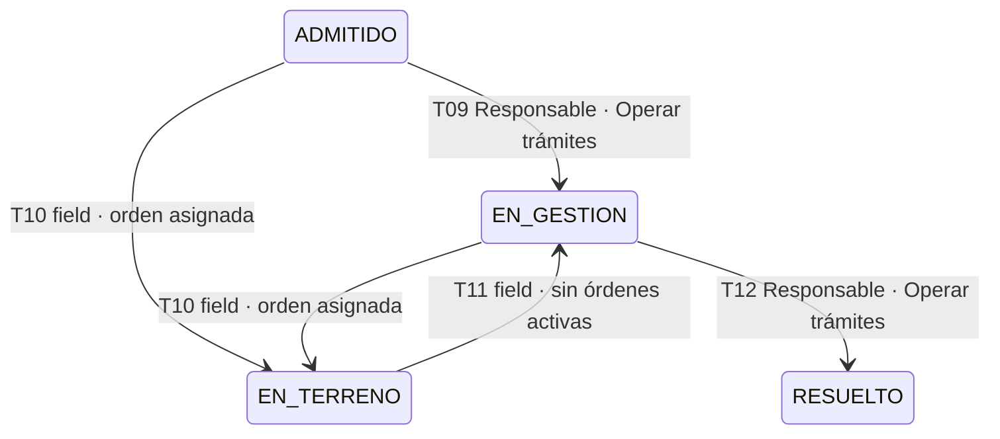
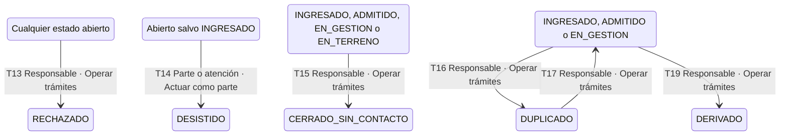
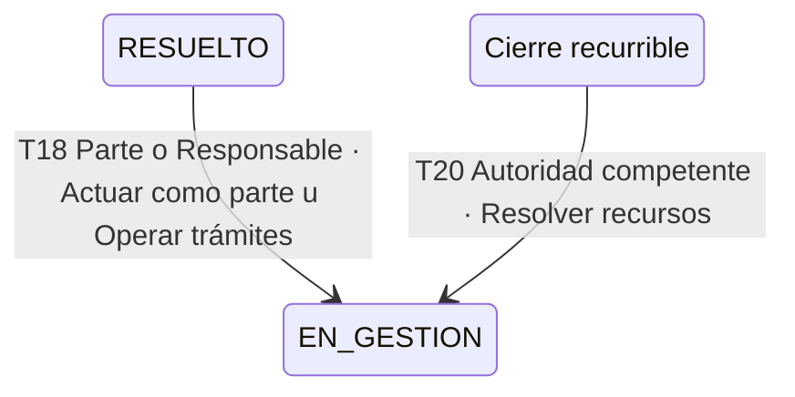

## Contrato: estados y transiciones del trámite (EP3.5-03)

Define la máquina de estados del trámite en EP3.5: los estados, cada transición con su actor y su capacidad, los recursos y los eventos que publica requests. La tabla vigente del `PUT /status` está en [`requests-estado.md`](requests-estado.md) y rige hasta que la reemplacen las tareas que implementan este contrato: EP3.5-22 (suspensión), EP3.5-23 (subsanación, desistimiento, cierre sin contacto y respuesta fundada), EP3.5-24 (terreno), EP3.5-30 (duplicados), EP3.5-31 (derivación), EP3.5-32 (recursos y reapertura) y EP3.5-35 (espera de cupo). Los plazos están en [`procedimiento-plazos.md`](procedimiento-plazos.md), qué se comunica en cada paso en [`comunicaciones.md`](comunicaciones.md) y los documentos en [`documentos.md`](documentos.md).

**Base legal, como fundamento de diseño:** la Ley 19.880 pide subsanar una solicitud incompleta en cinco días, bajo apercibimiento de tenerla por desistida (art. 31); enviar al órgano competente lo que no es de su competencia e informar al interesado (art. 14); permite el desistimiento del interesado (art. 42), y regula la reposición ante el mismo órgano que dictó el acto (art. 59). Estas reglas se aplican por analogía a las solicitudes de servicio y a la OIRS, como hace EP3-06 con los plazos. Qué tipos son procedimientos en sentido estricto es validación jurídica (catálogo, sección 5.2).

### 1. Principios

1. **requests es el único que escribe el estado.** field lo cambia solo a través de sus eventos (`field.md`, sección 6).
2. **Una acción, un endpoint, un evento.** Los cambios simples siguen en `PUT /status`. Cada acción con datos propios tiene su subrecurso `POST`, como la cancelación de EP3-76, y su propio tipo de evento.
3. **Los hechos del plazo van aparte.** Una acción que suspende o reanuda el plazo publica además `request.sla-suspended` o `request.sla-resumed` en la misma transacción. report no deduce la suspensión del estado. Todo cierre con una suspensión abierta publica antes `request.sla-resumed` (`procedimiento-plazos.md`, sección 3.1), aunque la tabla de la sección 4.5 no lo repita.
4. **Terminal es un conjunto, no una tabla vacía.** Los estados terminales son los de la sección 2. Hoy requests considera cerrado un estado sin transiciones salientes (`RequestTransitions.isClosed`); con la reapertura, `RESUELTO` tiene una salida y sigue siendo terminal.
5. **Todo cierre del municipio lleva respuesta pública** (sección 5).
6. **Los flujos por tipo (EP3.5-35) solo restringen** transiciones de este contrato; nunca agregan otras.
7. **Mismo bloqueo y mismo orden de errores.** Toda acción se aplica dentro del `findByIdForUpdate` del trámite y responde 403, 400, 404 y 409 en el orden de EP3-04, sección 5. Una transición que no está en la sección 4 responde 409.

### 2. Estados

| Estado | Tipo | Plazo de atención | Significado |
|---|---|---|---|
| `INGRESADO` | Abierto | Corre | Presentado, sin admitir |
| `EN_SUBSANACION` | Abierto | Suspendido | Espera antecedentes pedidos al vecino |
| `EN_ESPERA_CUPO` | Abierto | Suspendido | Admisible, sin cupo de admisión del día. Solo en tipos con tope de admisión (E9) |
| `ADMITIDO` | Abierto | Corre | Admitido, sin gestión iniciada |
| `EN_GESTION` | Abierto | Corre | En atención de la unidad |
| `EN_TERRENO` | Abierto | Corre | Con al menos una orden de trabajo activa |
| `RESUELTO` | Terminal | Detenido | Atendido, con respuesta fundada. Se puede reabrir (T18) |
| `RECHAZADO` | Terminal | Detenido | No procede, con motivo y respuesta fundada |
| `CANCELADO` | Terminal | Detenido | Retirado por el titular en `INGRESADO` (EP3-76) |
| `DESISTIDO` | Terminal | Detenido | El titular desistió, o se le tuvo por desistido al vencer la subsanación |
| `CERRADO_SIN_CONTACTO` | Terminal | Detenido | Cerrado por el municipio porque no logró contactar al vecino cuando lo necesitaba |
| `DERIVADO` | Terminal | Detenido | Enviado a otro órgano competente |
| `DUPLICADO` | Terminal | Detenido | Vinculado a un trámite principal, que sigue la atención |

**Por qué `CERRADO_SIN_CONTACTO` no es `DESISTIDO`.** El desistimiento es un acto del interesado (art. 42), y el abandono exige que el interesado paralice el procedimiento más de 30 días, un aviso previo con 7 días para retomarlo y una declaración notificada (art. 43). Un cierre porque el municipio no logró hablar con el vecino no cumple ninguno de los dos supuestos: no hay voluntad del vecino ni una paralización atribuible a él. Llamarlo desistimiento registraría como voluntad del vecino algo que no lo es, y mezclaría en los indicadores una falla de contacto con un retiro. Por eso es un estado propio, con su respuesta fundada y sus recursos. El abandono del art. 43 no se modela en EP3.5 (sección 9).

`DESISTIDO` sí agrupa dos causas, porque las dos son desistimiento en sentido legal: el desistimiento del titular (art. 42) y el que la ley presume al vencer la subsanación (art. 31, "se le tendrá por desistido"). `withdrawalReason` las distingue (sección 6).

### 3. Capacidades

EP3.5-13 asigna estas capacidades a los roles. Este contrato fija solo qué protege cada una, como `field.md`, sección 2.

| Capacidad | Permite |
|---|---|
| Ingresar trámites | Alta propia del vecino, o asistida en un punto de atención (EP3.5-16) |
| Actuar como parte | Cancelar, desistir, responder antecedentes, reabrir y presentar recursos sobre un trámite propio. La tiene el `TITULAR` o el `REPRESENTANTE` con `link_status = VINCULADA` (`dominio-modelo.md`, sección 3.3) |
| Atender en oficina | Registrar en nombre de una parte lo que ella presenta en persona: antecedentes, desistimiento o recurso (EP3.5-16). El historial registra a la parte y al funcionario que lo ingresó |
| Operar trámites | Las acciones del responsable sobre los trámites de su unidad (EP3-05 y EP3.5-14) |
| Intervenir trámites | Operar cualquier trámite con motivo interno, como el Admin de EP3-04, sección 3 |
| Aprobar prórrogas | Aprobar o rechazar las prórrogas de su unidad (`procedimiento-plazos.md`, sección 4) |
| Revisar recursos | Analizar un recurso y preparar su propuesta de resolución (sección 7) |
| Resolver recursos | Registrar la decisión de la autoridad competente sobre un recurso (sección 7) |

"Responsable" en la sección 4 es el funcionario responsable del trámite, con "Operar trámites". Cada transición del responsable la puede hacer también quien tiene "Intervenir trámites", con `interventionReason`.

### 4. Transiciones

#### 4.1 Admisión, subsanación y espera de cupo



#### 4.2 Gestión, terreno y resolución



#### 4.3 Otros cierres



#### 4.4 Después del cierre



"Cierre recurrible" es `RESUELTO`, `RECHAZADO`, `DERIVADO`, `CERRADO_SIN_CONTACTO`, `DUPLICADO` o `DESISTIDO` por `SUBSANACION_VENCIDA` (sección 7).

#### 4.5 Tabla de transiciones

| # | Desde | Hacia | Acción | Actor | Capacidad | Evento | Reglas |
|---|---|---|---|---|---|---|---|
| T01 | - | `INGRESADO` | `POST /api/requests` | Vecino, o funcionario de atención | Ingresar trámites | `request.created` | Como hoy. El ingreso asistido es de EP3.5-16 |
| T02 | `INGRESADO` | `ADMITIDO` | `PUT /status` | Responsable | Operar trámites | `request.status-changed` | El BFF reserva el cupo, como hoy (`dominio-contextos.md`, límite 1) |
| T03 | `INGRESADO` | `EN_ESPERA_CUPO` | `PUT /status` con `ADMITIDO` | Responsable | Operar trámites | `request.status-changed` y `request.sla-suspended` | Solo si el tipo tiene tope de admisión con lista de espera y el cupo del día se agotó. Sin lista de espera, sigue el 409 de hoy |
| T04 | `EN_ESPERA_CUPO` | `ADMITIDO` | Admisión automática, o `PUT /status` | Sistema, o responsable | Operar trámites, para la manual | `request.sla-resumed` y `request.status-changed` | El primer día hábil siguiente, requests admite en orden de `created_at` e `id` mientras haya cupo (sección 6.3) |
| T05 | `INGRESADO` o `ADMITIDO` | `EN_SUBSANACION` | `POST /remedy-request` | Responsable | Operar trámites | `request.remedy-requested` y `request.sla-suspended` | Lista de lo que falta y texto para el vecino, obligatorios. Guarda el estado de origen. El plazo de 5 días hábiles corre desde la notificación (`procedimiento-plazos.md`, sección 2) |
| T06 | `EN_SUBSANACION` | Estado de origen | `POST /remedy-response` | Parte, o funcionario de atención | Actuar como parte, o Atender en oficina | `request.remedy-answered` y `request.sla-resumed` | Comentario obligatorio y adjuntos opcionales. Se acepta después del vencimiento si el desistimiento no se confirmó. Si la respuesta es incompleta, el responsable pide de nuevo (T05) |
| T07 | `EN_SUBSANACION` | `DESISTIDO` | `POST /withdrawal` | Responsable | Operar trámites | `request.sla-resumed` y `request.withdrawn` | Solo con el plazo de subsanación vencido y sin respuesta. `withdrawalReason = SUBSANACION_VENCIDA`. Respuesta pública obligatoria |
| T08 | `INGRESADO` | `CANCELADO` | `POST /cancel` | Parte | Actuar como parte | `request.cancelled` | Como hoy (EP3-76) |
| T09 | `ADMITIDO` | `EN_GESTION` | `PUT /status` | Responsable | Operar trámites | `request.status-changed` | Como hoy |
| T10 | `ADMITIDO` o `EN_GESTION` | `EN_TERRENO` | Lectura de `workorder.assigned` | field, con el actor de su evento | Gestionar órdenes, en field | `request.status-changed` | `field.md`, sección 6.2. Hasta que field se despliegue, es un `PUT /status` del responsable desde `EN_GESTION`, como hoy |
| T11 | `EN_TERRENO` | `EN_GESTION` | Lectura de `field.events` | field, con el actor de su evento | Gestionar o Ejecutar órdenes, en field | `request.status-changed` | El trámite quedó sin órdenes activas (`field.md`, sección 6.2) |
| T12 | `EN_GESTION` | `RESUELTO` | `PUT /status` | Responsable | Operar trámites | `request.status-changed` | Respuesta pública obligatoria. Sin órdenes activas, y toda orden no cancelada `VALIDADA`. Hasta que field se despliegue, también desde `EN_TERRENO`, como hoy |
| T13 | Cualquier estado abierto | `RECHAZADO` | `PUT /status` | Responsable | Operar trámites | `request.status-changed` | `rejectionReason` y respuesta pública obligatorios |
| T14 | Abierto, salvo `INGRESADO` | `DESISTIDO` | `POST /withdrawal` | Parte, o funcionario de atención | Actuar como parte, o Atender en oficina | `request.withdrawn` | `withdrawalReason = DESISTIMIENTO_TITULAR`. Motivo libre opcional, que no viaja en eventos. En `INGRESADO` el titular cancela (T08) |
| T15 | `INGRESADO`, `ADMITIDO`, `EN_GESTION` o `EN_TERRENO` | `CERRADO_SIN_CONTACTO` | `POST /no-contact-closure` | Responsable | Operar trámites | `request.closed-without-contact` | Exige los intentos de la sección 6.2. Respuesta pública obligatoria |
| T16 | `INGRESADO`, `ADMITIDO` o `EN_GESTION` | `DUPLICADO` | `POST /duplicate-of` | Responsable | Operar trámites | `request.marked-duplicate` | Crea `DUPLICADO_DE` hacia el principal, que debe estar abierto y no ser duplicado (`dominio-modelo.md`, sección 3.4). Guarda el estado de origen |
| T17 | `DUPLICADO` | Estado de origen | `POST /duplicate-of/removal` | Responsable | Operar trámites | `request.duplicate-unmarked` | Motivo obligatorio. Elimina la relación |
| T18 | `RESUELTO` | `EN_GESTION` | `POST /reopening` | Parte, o responsable | Actuar como parte, u Operar trámites | `request.reopened` | Motivo obligatorio y dentro de 30 días corridos desde el cierre (E9). Conserva folio e historial. Fuera de plazo responde 409, y la interfaz ofrece un trámite nuevo `RELACIONADO` |
| T19 | `INGRESADO`, `ADMITIDO` o `EN_GESTION` | `DERIVADO` | `POST /referral` | Responsable | Operar trámites | `request.referred` | Órgano destino del catálogo de organismos (EP3.5-31). Respuesta pública obligatoria con los datos del órgano (art. 14) |
| T20 | Cierre recurrible | `EN_GESTION` | `POST /appeals/{id}/resolution` con `REABRE` | Autoridad competente | Resolver recursos | `request.appeal-resolved` y `request.reopened` | Sección 7 |

Las rutas son relativas a `/api/requests/{id}`. **Derivación interna:** cambiar la unidad responsable no cambia el estado. Es `POST /transfer`, con la unidad destino y un motivo; quita al responsable, devuelve el trámite a la bandeja de la unidad destino y publica `request.transferred` (EP3.5-31).

### 5. Respuesta pública al cerrar

| Cierre | Respuesta pública | Indica cómo reclamar |
|---|---|---|
| `RESUELTO`, `RECHAZADO`, `DERIVADO`, `CERRADO_SIN_CONTACTO` y `DESISTIDO` por `SUBSANACION_VENCIDA` | Obligatoria, redactada por el responsable desde una plantilla del tipo y del estado (EP3.5-23) | Sí, con el plazo del recurso (sección 7) |
| `DUPLICADO` | Texto fijo con el folio del trámite principal | Sí |
| `CANCELADO` y `DESISTIDO` por `DESISTIMIENTO_TITULAR` | No: es la voluntad del vecino. Recibe un acuse | No |

La respuesta queda en el historial público, en la comunicación de cierre y en el documento de respuesta (`documentos.md`). El vecino ve la unidad y el cargo del responsable; un acto oficial lleva además el nombre y el cargo de la autoridad que lo firma (D-05). No lleva `interventionReason`, notas internas ni datos de otras partes.

### 6. Reglas por acción

#### 6.1 Estado de origen

`EN_SUBSANACION` y `DUPLICADO` vuelven al estado desde el que se llegó. requests lo guarda en `status_before`, en la misma transacción. El vecino ve la vuelta como un paso más del historial, no como un retroceso.

#### 6.2 Cierre sin contacto

El municipio cierra sin contacto solo si necesitaba hablar con el vecino para seguir, después de **tres intentos sin contacto en al menos dos canales** (E9). Cuentan como intentos:
- las gestiones (`request.contact-logged`) con resultado `NO_CONTESTA`, `NUMERO_INCORRECTO`, `BUZON` o `VISITA_FALLIDA`, con su `channel` (`LLAMADA`, `CORREO`, `VISITA` o `MENSAJE`);
- los avisos de `notify.events` con estado `REBOTADO` o `FALLIDO`, como intentos por `CORREO` o `MENSAJE` según su canal (`comunicaciones.md`, sección 8).

Una gestión con resultado `CONTESTO` o `CONFIRMADO` posterior al primer intento reinicia la cuenta. Si no se cumple la regla, la acción responde 409. El próximo intento se programa solo en días y horario hábiles (EP3.5-23, criterio 7).

#### 6.3 Admisión desde la lista de espera

- La admisión automática corre una vez al día, en el primer día hábil de `America/Santiago`. Reserva cupo con la llamada interna a catalog (`dominio-contextos.md`, sección 4) y admite en orden de `created_at` e `id` hasta agotar el cupo. EP3.5-35 suma la prioridad al orden.
- Cada trámite va en su propia transacción, con su bloqueo. Un trámite que cambió de estado mientras esperaba (rechazado, desistido) no se toca. Si la reserva falla, el trámite sigue en espera hasta el día hábil siguiente, sin perder su lugar.
- El actor del evento es el sistema: `{ "id": "requests", "name": "Sistema", "role": "Sistema" }`. `Sistema` es un valor nuevo de `actor.role`, compatible con EP3-01, sección 11.

#### 6.4 Cierres con órdenes activas

Un cierre con órdenes activas (T13 a T16 y T19) hace que field las cancele (`field.md`, sección 6.3). La unidad recibe el aviso de la matriz de comunicaciones.

#### 6.5 Duplicados

- No se marca como duplicado de un trámite cerrado: en ese caso se usa `RELACIONADO` (EP3.5-30).
- El titular del duplicado recibe las comunicaciones públicas del principal, sin datos de su titular (TRA-11).
- Si el principal se reabre, sus duplicados siguen `DUPLICADO` y sus titulares reciben el aviso de reapertura.

### 7. Recursos

Un recurso es una presentación vinculada al trámite, no un estado: mientras se resuelve, el trámite sigue en su estado de cierre.

#### 7.1 Tipos

| `type` | Cuándo | Plazo para presentarlo | Ante quién | Quién resuelve |
|---|---|---|---|---|
| `REPOSICION` | Tipos configurados como procedimiento formal (EP3.5-33). Ninguno en EP3.5 (D-01) | 5 días hábiles desde la notificación del cierre (art. 59) | El mismo órgano que dictó el acto recurrido | Ese mismo órgano (art. 59). Contra un acto del alcalde no procede el jerárquico y la reposición agota la vía administrativa; la respuesta lo informa |
| `REVISION` | Solicitudes de servicio y OIRS | 5 días hábiles desde la notificación del cierre, configurable por tipo (EP3.5-09) | La municipalidad, desde el trámite | La autoridad que fija la ordenanza para cada tipo, configurada en catalog. Por defecto, la jefatura de la unidad responsable |

#### 7.2 Quién revisa y quién resuelve

Son dos papeles distintos:
- **Quien revisa** (Revisar recursos) analiza el recurso y prepara una propuesta. No es quien hizo el cierre recurrido. Es una regla de control interno de la plataforma (separación de funciones), no una regla jurídica.
- **Quien resuelve** (Resolver recursos) es la autoridad competente según el tipo de recurso, de la tabla anterior. En una `REPOSICION` es el mismo órgano que dictó el acto, aunque sea la misma persona que lo firmó. La plataforma no determina la competencia: registra la autoridad que configuró la municipalidad y quién firmó la decisión.

#### 7.3 Ciclo

1. `POST /api/requests/{id}/appeals`, con `type` y fundamentos, por una parte (Actuar como parte) o por atención en oficina (Atender en oficina). Fuera de plazo responde 409. Publica `request.appeal-filed`.
2. Quien revisa registra su propuesta, que es interna.
3. Quien resuelve registra la decisión, `POST /api/requests/{id}/appeals/{appealId}/resolution`, con `result` y una respuesta fundada, dentro de 30 días hábiles (art. 59). Publica `request.appeal-resolved`.

| `result` | Efecto |
|---|---|
| `CONFIRMA` | El cierre se mantiene |
| `MODIFICA` | El cierre se mantiene con una respuesta pública nueva, que reemplaza a la anterior en el historial público y genera un documento nuevo |
| `REABRE` | El trámite vuelve a `EN_GESTION` (T20). Si era `DUPLICADO`, se elimina la relación |

A lo más un recurso pendiente por trámite. Un trámite reabierto por un recurso puede volver a cerrarse, y ese nuevo cierre es recurrible.

### 8. Eventos de `requests.events`

Siguen el sobre, los formatos, la recepción y el versionado de EP3-01 (secciones 4, 5, 10 y 11). Todos son versión 1 y se escriben en el outbox en la misma transacción del cambio.

| `eventType` | Cuándo |
|---|---|
| `request.remedy-requested` | T05 |
| `request.remedy-answered` | T06 |
| `request.withdrawn` | T07 y T14 |
| `request.closed-without-contact` | T15 |
| `request.marked-duplicate` | T16 |
| `request.duplicate-unmarked` | T17 |
| `request.reopened` | T18 y T20 |
| `request.referred` | T19 |
| `request.transferred` | Derivación interna (sección 4.5) |
| `request.appeal-filed` | Recurso presentado (sección 7.3) |
| `request.appeal-resolved` | Recurso resuelto (sección 7.3) |
| `request.sla-suspended`, `request.sla-resumed` | `procedimiento-plazos.md`, sección 3 |
| `request.extension-requested`, `request.extension-decided` | `procedimiento-plazos.md`, sección 4 |

`request.status-changed` suma los valores `EN_ESPERA_CUPO` en `toStatus` (T03) y `fromStatus` (T04), y el cambio de `EN_GESTION` a `RESUELTO` (T12).

**Campos del payload.** Todos llevan `requestId` y `folio`, no nulos. Los que cambian el estado (`remedy-requested`, `remedy-answered`, `withdrawn`, `closed-without-contact`, `marked-duplicate`, `duplicate-unmarked`, `reopened` y `referred`) llevan además `procedureType`, `sector`, `fromStatus` y `toStatus`, como `request.status-changed`, y `interventionReason` cuando actúa quien tiene Intervenir trámites.

| Evento | Campos propios |
|---|---|
| `remedy-requested` | `itemCount` (entero ≥ 1, cantidad de antecedentes pedidos) |
| `remedy-answered` | `late` (boolean: respondió después del vencimiento) y `hasAttachment` (boolean) |
| `withdrawn` | `withdrawalReason`: `DESISTIMIENTO_TITULAR` o `SUBSANACION_VENCIDA` |
| `closed-without-contact` | `attemptCount` y `channelCount` (enteros) |
| `marked-duplicate`, `duplicate-unmarked` | `primaryRequestId` (uuid) y `primaryFolio` |
| `reopened` | `cause`: `PARTE`, `PERSONAL` o `RECURSO`; `reopenCount` (entero ≥ 1) |
| `referred` | `organizationCode` (código del catálogo de organismos) |
| `transferred` | `fromOrgUnitId` y `toOrgUnitId` (uuid), `reason` |
| `appeal-filed` | `appealId` (uuid), `appealType` y `againstStatus` (el estado de cierre recurrido) |
| `appeal-resolved` | `appealId`, `appealType` y `result` |

**Minimización** (EP3-01, sección 8). No viajan la lista de antecedentes, la respuesta del vecino, sus fundamentos ni su motivo de desistimiento, ni la respuesta pública del cierre: son texto libre que puede tener datos personales, y ningún consumidor los necesita. Viaja `reason` en la derivación interna, por la misma razón que el motivo de reasignación: explica una decisión del personal.

**Ejemplo**, `request.withdrawn` por subsanación vencida:

```json
{
  "eventId": "4d5e6f70-8192-4a3b-9c4d-5e6f70819203",
  "eventType": "request.withdrawn",
  "schemaVersion": 1,
  "occurredAt": "2026-12-02T14:20:00.000Z",
  "producer": "requests",
  "traceId": "ee55ff66-0077-4188-9229-33445566778a",
  "sequence": 1203,
  "actor": { "id": "8e7f6a5b-4c3d-4e2f-9a1b-0c9d8e7f6a5b", "name": "Funcionario Test", "role": "Funcionario" },
  "payload": {
    "requestId": "7b6e1d44-2a18-4c90-9f01-88aa11bb22cc",
    "folio": "BD-2026-000123",
    "procedureType": "bache",
    "sector": "ralco",
    "fromStatus": "EN_SUBSANACION",
    "toStatus": "DESISTIDO",
    "interventionReason": null,
    "withdrawalReason": "SUBSANACION_VENCIDA"
  }
}
```

**Consumidores:**

| Consumidor | Qué hace |
|---|---|
| report | Cierra la proyección en los estados terminales nuevos y aplica la sección 5 de `procedimiento-plazos.md`. Suspende y reanuda el plazo. Cuenta reaperturas, recursos y su resultado, y separa duplicados del volumen neto |
| audit | Guarda todos los tipos, como hoy |
| field | Trata `DESISTIDO`, `CERRADO_SIN_CONTACTO`, `DERIVADO` y `DUPLICADO` como terminales y retira el trámite de sus órdenes (`field.md`, sección 6.3) |

**Orden de despliegue** (convención 11 del backlog):
1. report, audit y field aceptan los tipos nuevos y los valores nuevos de estado. Un consumidor viejo ignoraría un tipo desconocido (EP3-01, sección 10), pero proyectaría mal un `toStatus` desconocido en `request.status-changed`.
2. requests publica.

### 9. Límites conocidos

1. **Sin abandono (art. 43).** Exige un aviso previo y una declaración de la autoridad, y solo tiene sentido en procedimientos formales, que EP3.5 no tramita (D-01). Si se habilitan, se agrega como estado propio.
2. **Sin recurso jerárquico.** Procede contra actos de autoridades con superior, que EP3.5 no registra. Contra el alcalde no procede (art. 59).
3. **`CANCELADO` y `DESISTIDO` del titular son el mismo acto** (art. 42) con dos nombres: `CANCELADO` se conserva en `INGRESADO` por compatibilidad con EP3-76 y con los datos existentes. report los muestra juntos como retiro del vecino.
4. **Continuar pese al desistimiento.** Si el problema sigue siendo de interés municipal (un bache que sigue ahí), la unidad lo atiende con un trámite o una orden propia. Si una ley permite seguir el mismo procedimiento es validación jurídica.
5. **Admisión automática con una instancia.** El orden de la lista de espera se garantiza con una sola instancia del proceso diario (ARQ-03). Con dos, el bloqueo evita admitir dos veces, pero el orden entre trámites puede variar.
6. **Competencia para resolver.** La plataforma registra la autoridad configurada; no valida si es la competente.
