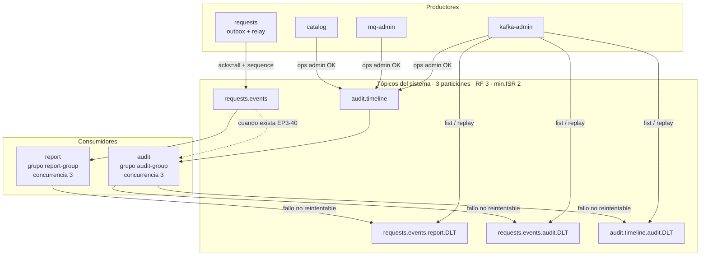

# Kafka en BarrioDigital

Guía de uso del clúster y de los tópicos del sistema (EP3). Contratos: `decisiones.md` (EP3-01 a EP3-03, EP3-07). Compose local: `kafka/README.md`. EC2: EP3-15 / `docs/evidencias/EP3-15-ec2-kafka.md`. Corte de nube: EP3-56.

## 1. Diagrama: tópicos, productores, consumidores y grupos

| Tópico | Productores | Consumidores (grupo) | DLT |
|---|---|---|---|
| `requests.events` | requests (relay del outbox) | report (`report-group`); audit (`audit-group`) cuando cierre EP3-40 | `requests.events.report.DLT`, `requests.events.audit.DLT` |
| `audit.timeline` | catalog, mq-admin, kafka-admin | audit (`audit-group`) | `audit.timeline.audit.DLT` |

Los tópicos del sistema los crea **kafka-admin** al arrancar (`auto.create.topics.enable=false`). Admin puede crear tópicos de carga aparte (no sistema).

## 2. Casos de uso

| Caso | Qué ocurre |
|---|---|
| Alta / cambio de trámite | requests escribe outbox en la misma TX Oracle; el relay publica a `requests.events` con key=`requestId` y `sequence`. |
| KPIs y plazos | report consume `requests.events`, proyecta en Oracle, API `/api/report/**` (Admin/Auditor vía BFF). |
| Auditoría de configuración | catalog / mq-admin / kafka-admin publican en `audit.timeline` con `actor.sourceIp` (BFF reenvía `X-Source-Ip` del Gateway). |
| Timeline del trámite | Contrato: audit guarda eventos de ambos tópicos (EP3-07). **Hoy en lab:** consumidor `audit.timeline` (EP3-41) sí; consumidor `requests.events` + API timeline (EP3-40/42) aún abiertos. El historial operativo vive en `request_activity` de requests. |
| Caída de Kafka | HTTP de requests sigue; outbox acumula; al volver el relay publica en orden de `event_sequence`. |
| Caída de un broker | ISR baja a 2; con `min.insync.replicas=2` el clúster sigue escribiendo. |
| Consumidor caído | El lag del grupo crece en Kafka UI; al subir, catch-up. |
| Mensaje inválido | Tras reintentos del contrato → DLT; revisión y replay desde kafka-admin. |

## 3. Demos paso a paso

### 3.1 Local: levantar Kafka + ver tópicos

1. En `barriodigital-infra/kafka`: copiar `.env.example` → `.env`, poner `KAFKA_HOST_IP` = IP LAN del PC.  
2. `docker compose -f kafka/compose.yml --env-file kafka/.env up -d --wait`  
3. Abrir Kafka UI en `http://localhost:8090`.  
4. Arrancar **kafka-admin** (compose de apps o `spring-boot:run`) con `KAFKA_BOOTSTRAP_SERVERS` apuntando a esa IP `:9092,:9093,:9094`.  
5. Comprobar tópicos sistema (3p / RF3) en UI o `GET /api/kafka/topics` (vía BFF + JWT Admin, o token interno en red Docker).

Detalle de puertos y listeners: `kafka/README.md`.

### 3.2 Nube (lab): orden de despliegue

1. EC2 Kafka (3 brokers + ZK + UI) — ver EP3-15.  
2. kafka-admin en EC2 apps (crea tópicos).  
3. report + audit.  
4. requests + catalog + mq-admin (+ notify).  
5. BFF; front en Amplify.

Layout JAR en EC2: `apps/compose.ec2.jars.yml`. Variables: `KAFKA_BOOTSTRAP_SERVERS` (IP **privada** de ec2-kafka), `INTERNAL_TOKEN`.

### 3.3 Flujo trámite → KPIs (sin mocks)

1. Vecino: `POST /api/requests` (Gateway + JWT).  
2. Funcionario: `POST .../take` → `PUT .../status` ADMITIDO → EN_GESTION → `POST .../gestiones` → EN_TERRENO → RESUELTO.  
3. En &lt; 5 s: `GET /api/report/kpis?range=last24h` refleja el cierre (`lastEventAt`, contadores).  
4. Evidencia de lab: `docs/evidencias/ep3-56-flujo-tramite.txt`.

### 3.4 Auditoría de configuración + IP

1. Admin cambia cupo en catalog (o vía BFF).  
2. Admin crea una cola en mq-admin.  
3. En Kafka UI / consola: eventos `procedure-type.updated` y `queue.created` en `audit.timeline` con `actor.sourceIp`.  
4. Evidencia: `docs/evidencias/ep3-56-audit-config-ip.txt`.

### 3.5 Caos corto

| Prueba | Cómo | Qué esperar |
|---|---|---|
| Un broker down | `docker stop kafka-3` | ISR=2; altas de trámite OK |
| Kafka down | stop de los 3 brokers | `PUT /status` 200; outbox pendiente; al subir, `relay-reanudado` |
| report down | `docker stop bd-report` | lag `report-group` ↑; al subir, lag=0 |
| Malformado | producir JSON sin `eventType` a `requests.events` | mensaje en `requests.events.report.DLT`; list/replay en kafka-admin |

Evidencia: `docs/evidencias/ep3-56-caos-kafka.txt`.

### 3.6 Regresión Rabbit

Tras el flujo de trámite, notify debe loguear email simulado, `crew-ticket` y `certificate-pdf` (mismo corte EP3-56).

## 4. Prueba de uso (criterio EP3-57)

El recorrido de las demos 3.2–3.6 se ejecutó en el lab el **12-nov-2026** (corte EP3-56) por el par de infra siguiendo este orden de despliegue y los pasos de caos/KPI; resultó operable.  
Registro: `docs/evidencias/ep3-56-*.txt` y `docs/evidencias/ep3-57-prueba-uso.txt`.

## 5. Topología de referencia (lab Learner Lab)

Valores de un corte concreto; la IP pública de apps cambia al reiniciar la EC2.

| Pieza | Valor típico |
|---|---|
| EC2 Kafka | privada `172.31.0.172` · UI `:8090` |
| EC2 Apps | BFF `:8080` · bootstrap `172.31.0.172:9092,9093,9094` |
| Gateway | `https://0yo277ntr8.execute-api.us-east-1.amazonaws.com` |

## 6. Oracle / outbox (antes del primer relay)

Si Hibernate creó `outbox_events` sin identity, el relay falla con `El evento no tiene event_sequence`. Aplicar `db/outbox-events.sql` de requests **antes** del primer arranque con outbox (EP3-02 / EP3-31).  
También: `folio` (EP3-28), PK `pk_processed_events` en report, CHECK de `kind` con `ASIGNACION` en `request_activity`.

## 9. Límites conocidos

Alineados a EP3-01 §12 y EP3-02 §9 (detalle en `decisiones.md`):

1. **Al menos una vez**, no exactly-once de Kafka: idempotencia por `eventId` / `processed_events` y `sequence` por trámite.  
2. **Sin transacciones de Kafka**; la atomicidad del productor es la TX Oracle del outbox.  
3. **Un broker caído:** escribe; **dos caídos:** no escribe (`min.insync.replicas=2`); requests acumula en outbox.  
4. **`audit.timeline` compact+delete (7 días):** si audit está caído más de la retención, puede perder eventos intermedios; vigilar lag de `audit-group`.  
5. **Rabbit ≠ Kafka:** avisos/PDF/tickets siguen en Rabbit; Kafka no los reemplaza.  
6. **API timeline / consumidor audit de `requests.events`:** contrato EP3-07/40/42; implementación de timeline HTTP pendiente de cierre en audit.  
7. **Replay DLT:** requiere mensaje con metadatos de destino útiles; un JSON suelto sin headers puede listarse y aún así marcarse `OMITIDO` al replay.  
8. **Una instancia de requests** asume el relay (sin locking distribuido del outbox en este diseño).  
9. **Secretos:** `.env` y wallet fuera de Git; `INTERNAL_TOKEN` solo en red interna / BFF.
