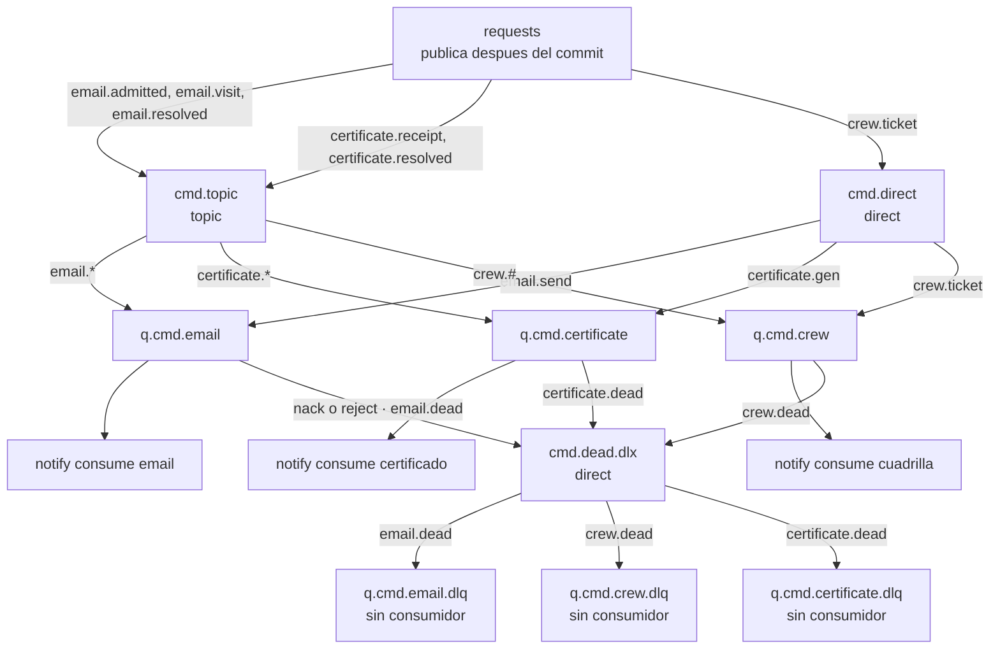

# Diagrama de RabbitMQ y mensaje muerto (EP2-33)

requests publica después del commit. notify consume las tres colas de trabajo. Un `basicNack` o `basicReject` con `requeue=false` sale por `cmd.dead.dlx` y se queda en la DLQ, que no tiene consumidor.



requests usa las routing keys de la izquierda. `email.send`, `certificate.gen` y `crew.#` están declarados para publicar a mano desde el Management UI. Las colas son clásicas y durables: viven en el nodo que las posee. El segundo nodo completa el clúster y no las replica.

Los nombres son los de `docs/decisiones.md`, contrato EP2-02. El ACK y la DLQ son el contrato EP2-03.

## Levantar el clúster y ver los dos nodos

En la EC2 `ec2-mq`, dentro del directorio que tiene `mq/compose.yml` y `mq/.env`:

```bash
sudo docker compose -f mq/compose.yml --env-file mq/.env up -d
sudo docker compose -f mq/compose.yml ps
sudo docker exec rabbitmq-1 rabbitmqctl cluster_status
```

`ps` muestra `rabbitmq-1` y `rabbitmq-2` healthy. En `cluster_status`, Running Nodes lista `rabbit@rabbitmq-1` y `rabbit@rabbitmq-2`. La misma pareja aparece en el Management UI, en Nodes.

El Management UI de este lab es `http://50.17.64.22:15672`. El usuario es `barriodigital`. La password está en `mq/.env` de esa instancia, no en git. AMQP escucha solo en la IP privada `172.31.46.156:5672`.

No usar `docker compose down -v`.

## Provocar un mensaje muerto

Con notify y requests ya conectados al broker, en el Management UI entra a Exchanges, abre `cmd.topic` y publica un mensaje.

- Routing key: `email.admitted`
- Delivery mode: 2 (persistent)
- Payload:

```json
{
  "type": "email.admitted",
  "eventId": "11111111-2222-4333-8444-555555555555",
  "timestamp": "2026-10-18T21:40:00Z",
  "traceId": "aaaaaaaa-bbbb-4ccc-8ddd-eeeeeeeeeeee",
  "correlationId": "tramite-dlq-1",
  "payload": {
    "requestId": "tramite-dlq-1",
    "procedureType": "bache",
    "procedureLabel": "Bache en calle",
    "address": "Los Aromos 120",
    "solicitanteEmail": null
  }
}
```

`email.admitted` calza con el binding `email.*` y entra a `q.cmd.email`. notify lo toma. `solicitanteEmail` en null no se puede reintentar: hace `basicReject(requeue=false)` al primer intento. RabbitMQ lo publica en `cmd.dead.dlx` con routing key `email.dead` y queda en `q.cmd.email.dlq`.

### Dónde verlo

En el Management UI, Queues, `q.cmd.email.dlq`: Ready pasa a 1 y Consumers sigue en 0. Get messages muestra el JSON.

En la EC2 de apps, el log de notify:

```bash
sudo docker logs bd-notify 2>&1 | grep mensaje-muerto
```

La línea es:

```text
ERROR mensaje-muerto cola=q.cmd.email eventId=11111111-2222-4333-8444-555555555555 motivo="solicitanteEmail debe ser una direccion unica valida" intentos=0
```

`q.cmd.email.dlq` no tiene consumidor ni dead-letter propio. El mensaje permanece hasta que alguien lo saque con Get messages y ack, o lo borre desde el UI.
